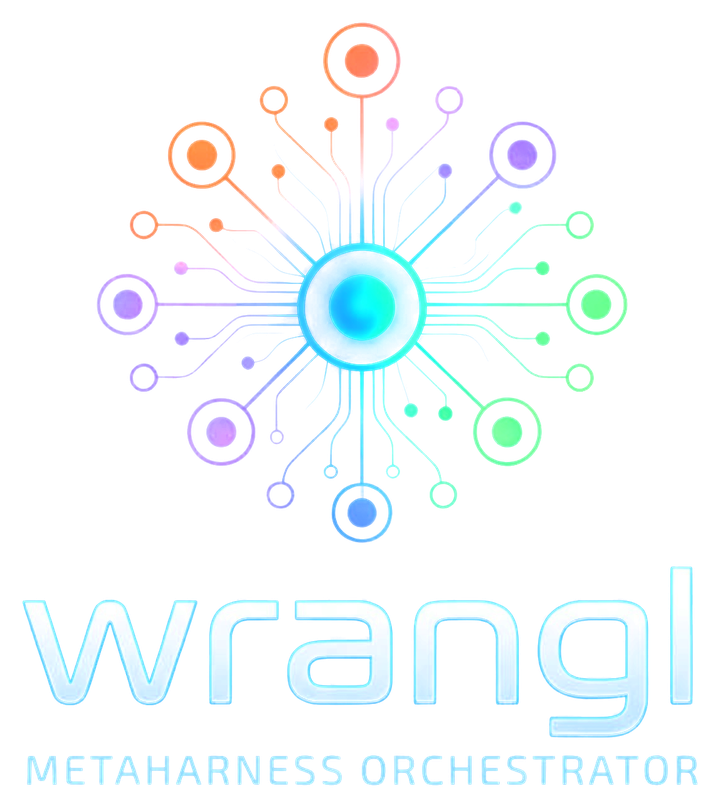
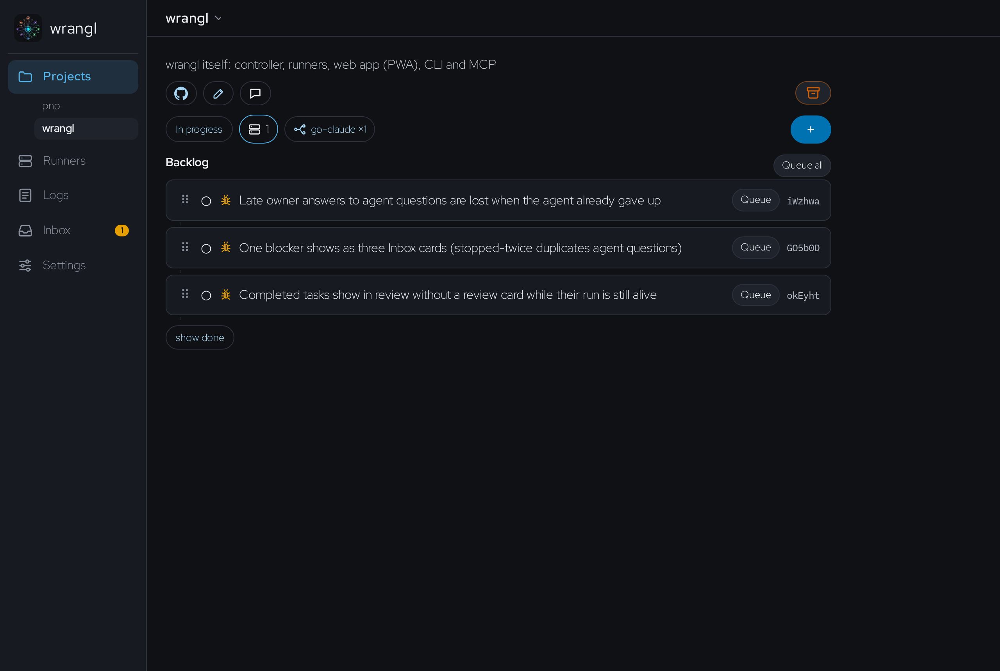
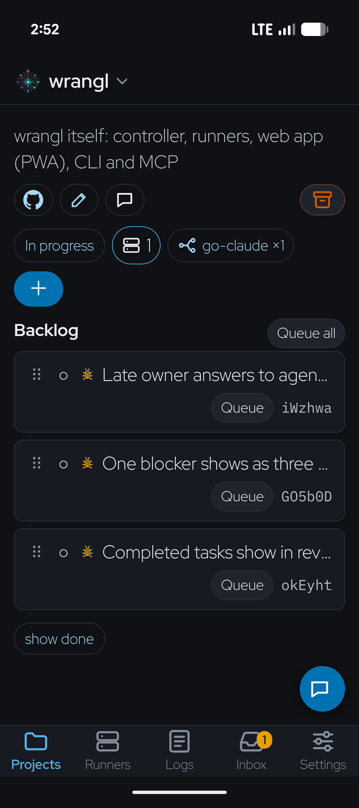
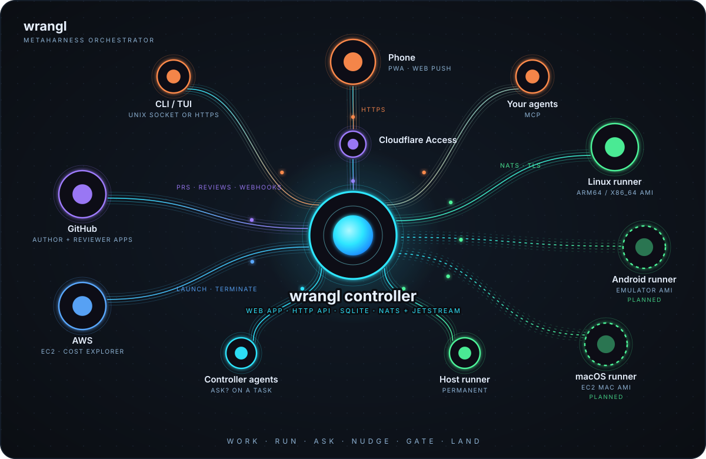

# wrangl

<p align="center"></p>

**W**ork, **R**un, **A**sk, **N**udge, **G**ate, **L**and: put work on a backlog, run it on a
fleet of coding agents, answer what they ask, steer them, gate what they produce, and land it.

wrangl is a self-hosted controller for a fleet of coding agents (Claude Code, Codex, Gemini CLI
and others). You keep one ranked backlog; wrangl runs it on disposable cloud machines, hands you the
questions and the pull requests, and stays out of your way the rest of the time. It is one Go
binary that runs as the **controller** (SQLite, embedded NATS + JetStream, HTTP API) or as a
**runner**, plus the CLI/TUI client. Design:
[`docs/superpowers/specs/2026-10-31-wrangl-design.md`](docs/superpowers/specs/2026-10-31-wrangl-design.md).

<p align="center">
  
  
</p>

## Getting started

Install the `wrangl` binary (macOS on Apple silicon, Linux on x86_64 or arm64):

```sh
curl -fsSL https://github.com/AgenticWrestling/wrangl/releases/latest/download/install.sh | sh
wrangl version
```

It puts `wrangl` in `~/.local/bin` (set `WRANGL_INSTALL_DIR` to change that, `WRANGL_VERSION=v0.1.0` to
pin a release) after checking its SHA-256. Everything is that one binary: controller, runner, CLI,
TUI and MCP server.

- **Windows:** use WSL and run the command above in the WSL shell, or clone the repo and
  [compile it from source](docs/wrangl/DEVELOPMENT.md#build-from-source). There is no native Windows build.
- **Intel Macs:** no prebuilt binary; [build from source](docs/wrangl/DEVELOPMENT.md#build-from-source).

Then set up a controller: [`docs/wrangl/INSTALL.md`](docs/wrangl/INSTALL.md) takes an empty AWS account
to a working controller, one GitHub App and a first task. To only drive an existing controller
from your laptop, point the CLI at it (`wrangl config`, `--controller https://your-host`).

## Why yet another metaharness??

Because the agent harnesses are good and getting better, and what's missing is the layer above
them: a backlog, a fleet, and a way to stay in the loop from your phone.

- **Use any coding harness.** The agent is just a command in a runner template. Templates ship for
  Claude Code, Codex, Gemini CLI and Antigravity, so you can mix them and switch as the field moves.
  wrangl never wraps or reimplements the harness; it drives the real CLI in a PTY.
- **One simple binary per host.** Controller, runner, CLI, TUI and MCP server are all the same
  `wrangl` executable. The controller is SQLite plus an embedded NATS: no Postgres, Redis or
  Kubernetes to run. Runners enrol with a token and upgrade themselves.
- **Mobile-first.** An installable PWA with web push makes planning, reviewing and completing
  projects easy from anywhere: triage the inbox, reorder the backlog, approve a merge, or open a
  terminal on a runner, all from a phone.
- **Plan at any granularity.** One ranked hierarchy from release down to task. Queue a whole
  milestone or a single leaf, and agents can split and manage their own subtasks.
- **Your repos, your PRs.** Work lands as ordinary branches and pull requests, with a checkpoint
  commit per subtask and a separate review run. Nothing wrangl-specific ends up in your repo.
- **You only get pulled in when it matters.** Questions, approvals and risky merges arrive in one
  inbox; low-risk work auto-merges.
- **Disposable and cost-aware.** Runners are EC2 instances launched from a template and reaped after
  30 idle minutes. The Runners page shows month-to-date spend, forecast and hourly burn, and lists
  anything else running in the account.
- **Self-hosted, no inbound ports.** It runs in your AWS account and talks to your GitHub through
  Apps you own. Remote access is behind Cloudflare Access, and runners need no inbound access from
  the internet.
- **Drivable by agents too.** Everything in the UI is in the CLI and an MCP endpoint, and "Ask?"
  on a task gets you a controller agent that can propose changes for one-click approval.

## How it fits together

<p align="center"></p>

The phone talks only to the controller. Runners need no inbound access from the internet: each one enrols with a
one-time token, then dials the controller's NATS (TLS). Details, and a text version of the diagram, are in
[`docs/wrangl/DESIGN.md`](docs/wrangl/DESIGN.md#how-it-fits-together). Only the Linux runner image is built and tested today.

## What it does

- **Backlog.** A ranked hierarchy per project, release > milestone > feature > task, with dependencies,
  typed tasks, GitHub issues pulled in as tasks, and agents or you splitting work down.
- **Runs.** Queue any task at any depth. wrangl launches an EC2 runner from a template, runs the agent
  in a PTY, makes a checkpoint commit per subtask, and reaps the runner when idle.
- **Review and merge.** A finished run opens a pull request and a separate review run assesses it;
  low-risk work auto-merges, conflicts get a Smart Merge run.
- **Inbox.** Questions, approvals, plans, reviews, deliverables and tool failures in one place, with web push.
- **Projects and chat.** Per-project queue, backlog and runners, plus a controller agent that proposes
  changes you approve with a button ("Ask?" on any task works the same way).
- **Fleet and cost.** Live runners with a web terminal, month-to-date spend, forecast and hourly burn.
- **Interfaces.** An installable mobile PWA, the CLI, a TUI, and an MCP endpoint
  ([tool list](docs/wrangl/mcp.md)).

Each is explained in [`docs/wrangl/DESIGN.md`](docs/wrangl/DESIGN.md). Status: **M1 to M10 built**, tested
against fakes for AWS, GitHub and the agents; the install guide's first-run checklist says what still needs a real account.

## Documentation

Start at the index, [`docs/wrangl/README.md`](docs/wrangl/README.md).

| Read | For |
|---|---|
| [INSTALL](docs/wrangl/INSTALL.md), [AWS setup](docs/wrangl/aws-iam.md) | controller, AWS, GitHub Apps, Cloudflare, teardown |
| [DESIGN](docs/wrangl/DESIGN.md) | architecture and what each feature does |
| Guides: [projects](docs/wrangl/guide/projects.md), [tasks](docs/wrangl/guide/tasks.md), [runners](docs/wrangl/guide/runners.md), [scheduling](docs/wrangl/guide/scheduling.md) | how the pieces behave |
| [MCP tools](docs/wrangl/mcp.md), [agent skill](docs/wrangl/skill/) | driving wrangl from your own agents |
| [Templates](docs/wrangl/templates/), [agents](docs/wrangl/agents.md), [Android](docs/wrangl/android.md) | runner templates and agent definitions |
| [Decisions (ADRs)](docs/wrangl/adr/) | why it is built this way |
| [DEVELOPMENT](docs/wrangl/DEVELOPMENT.md), [release notes](docs/releases/) | building from source, the web UI conventions, releasing |
