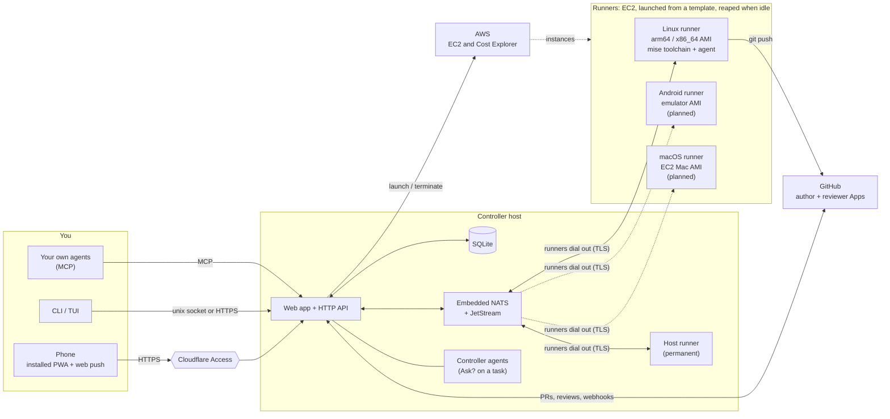

# wrangl

<p align="center"></p>

**W**ork, **R**un, **A**sk, **N**udge, **G**ate, **L**and: put work on a backlog, run it on a
fleet of coding agents, answer what they ask, steer them, gate what they produce, and land it.

wrangl is a self-hosted controller for a fleet of coding agents (Claude Code, Codex, Gemini CLI
and others). You keep one ranked backlog; wrangl runs it on disposable cloud machines, hands you the
questions and the pull requests, and stays out of your way the rest of the time. It is one Go
binary that runs as the **controller** (SQLite, embedded NATS + JetStream, HTTP API) or as a
**runner**, plus the CLI/TUI client. Design:
[`docs/superpowers/specs/2026-10-31-wrangl-design.md`](docs/superpowers/specs/2026-10-31-wrangl-design.md).

## How it fits together



The phone talks only to the controller. The terminal you open on a runner, the live backlog and
the inbox all come through it. Runners need no inbound access from the internet: each one enrols with a
one-time token, then dials the controller's NATS (TLS) over the shared VPC. Dashed boxes and lines are planned:
only the Linux runner image is built and tested today.

## What it does

**Backlog.** A hierarchical, ranked task stack per project: release > milestone > feature >
task, with dependencies ("needs"), target dates and progress roll-ups. Tasks have types (`code`,
`bug`, `ux`, `architecture`, `docs`, `research`, `review`) that change how the agent is prompted and
what it hands back. Pull GitHub issues in as tasks. Split a task by hand, or ask an agent to
propose the split and accept it from the inbox.

**Runs.** Queue any task, at any depth, and wrangl runs its subtree.
- It launches a tagged EC2 runner from a **template** (a mise toolchain, a setup script, size
  limits and the agent command), installs it for an unprivileged `agent` user, and terminates it
  after 30 idle minutes. The controller host can enrol itself as a permanent runner.
- The agent runs in a PTY, headless or as one interactive session with optional Remote Control.
  Templates ship for Claude Code, Codex, Gemini CLI and Antigravity.
- Agents manage their own subtasks and ask you things through MCP tools. A checkpoint commit is made
  per subtask.
- Runners upgrade themselves when the controller does, and template edits roll out to live runners.

**Review and merge.** A finished run opens a pull request and a separate review run assesses it.
Low-risk work auto-merges, and the rest waits for you. Each GitHub account gets an author App (pushes
and opens PRs) and a reviewer App (approves and merges, and receives webhooks), both created through
GitHub's manifest flow from the Settings page.

**Inbox.** Agent questions, approvals, plan proposals and deliverables (mockup images, prototype
links, markdown reports) arrive in one place, with web push on the installed app.

**Ask the controller.** "Ask?" on any task starts a thread with a lightweight controller agent (the
installed `claude` CLI on the controller host, boxed to read tools and the `wrangl` CLI). It sees the
task and its subtree, can reach other tasks through the CLI, and replies with up to five
one-click proposed actions (add a task, move tasks between parents, split, queue, and so on) that
run only when you approve them.

**Fleet and cost.** The Runners page shows live and recent runners, a web terminal on each (one tab
per agent session, plus shells), and AWS spend: month to date, forecast, hourly burn, and a breakdown
of what is in "EC2 - Other". Instances wrangl didn't launch are listed so you can adopt or
terminate them. The Logs page merges runs with runner, template and upgrade events.

**Interfaces.** An installable mobile PWA (Datastar, no build step), the `wrangl` CLI, a TUI, and an
MCP endpoint (`wrangl mcp`) so your own agents can read and edit the backlog. Remote access sits
behind Cloudflare Access, and on the controller host the CLI uses a unix socket with no auth.

Status: **M1 to M10 built**, tested against fakes for AWS, GitHub and the agents. See the install
guide's first-run checklist for what still needs a real account.

## Install and run

[`docs/wrangl/INSTALL.md`](docs/wrangl/INSTALL.md) covers AWS, the controller host, the GitHub Apps,
the Claude token, templates, Cloudflare, and teardown. AWS setup (instance roles, security group,
teardown): [`docs/wrangl/aws-iam.md`](docs/wrangl/aws-iam.md). Template examples are in
[`docs/wrangl/templates/`](docs/wrangl/templates/), and the agent skill that teaches Claude to drive
the CLI is in [`docs/wrangl/skill/`](docs/wrangl/skill/).

```sh
task build-wrangl      # build/wrangl + build/wrangl-linux-{aarch64,x86_64}
task sqlc              # regenerate cmd/wrangl/internal/db/dbgen after editing SQL
task sqlc-check        # fail if dbgen is stale

build/wrangl --config ./c.yaml controller init --data-dir ./data
build/wrangl --config ./c.yaml controller serve
curl --unix-socket /run/wrangl/api.sock http://x/healthz

build/wrangl template create -f template.yaml
build/wrangl fleet launch --template go-claude     # tagged EC2 instance, enrols itself
build/wrangl fleet list
build/wrangl task tree my-project                  # the ranked backlog
build/wrangl task ask SQID "Any concerns?" --wait  # ask a controller agent
build/wrangl fleet teardown                        # terminate every tagged instance
```

The logo and icons are built from `docs/brand/source.jpg` by `docs/brand/make-logo.py`; see
[`docs/brand/`](docs/brand/README.md).

---

## Also in this repo: ssm

A single binary for connecting to, tunnelling into, and provisioning EC2 instances via AWS SSM and EC2 Instance Connect — no open inbound ports required.

### Prerequisites

- [AWS CLI v2](https://docs.aws.amazon.com/cli/latest/userguide/install-cliv2.html) with the [Session Manager plugin](https://docs.aws.amazon.com/systems-manager/latest/userguide/session-manager-working-with-install-plugin.html)
- AWS profiles configured in `~/.aws/config`
- Go 1.21+
- [Task](https://taskfile.dev) (`brew install go-task`)

### Build & Install

```sh
task install   # builds to ./build/ssm then copies to ~/bin/ssm
```

Or just build:

```sh
task build     # ./build/ssm
```

### Usage

All subcommands prompt for an AWS profile first, then accept an optional `region/name` argument (e.g. `us-west-2/myhost`). If omitted, a fuzzy picker lists all running instances in the default region.

#### `ssm connect [region/name]`

Open an interactive SSM Session Manager terminal on the instance.

```sh
ssm connect
ssm connect us-west-2/myhost
```

#### `ssm tunnel [region/name] <rport>[:<lport>] [--open]`

Forward a remote port to localhost via SSM. `--open` launches the browser once the tunnel is ready.

```sh
ssm tunnel us-west-2/myhost 3000          # localhost:3000 → remote:3000
ssm tunnel us-west-2/myhost 3000:8080     # localhost:8080 → remote:3000
ssm tunnel us-west-2/myhost 3000 --open   # opens http://localhost:3000
```

#### `ssm setup [region/name]`

Provision a fresh Amazon Linux instance with a full development toolchain:

- AWS CLI v2
- EC2 Instance Connect
- Fish shell (set as default)
- Go
- Rust
- Zed remote server
- Headless Chrome

Also configures:
- EC2 Instance Connect Endpoint in the instance's VPC (created if absent)
- SSH ingress rule (port 22 from VPC CIDR) on the instance's security group
- Local Ed25519 keypair (`~/.ssh/id_ed25519`) generated if absent
- `~/.ssh/config` `Host` block so `ssh myhost` and Zed remote just work

Streams CloudWatch Logs output until provisioning completes.

```sh
ssm setup us-west-2/myhost
```

### Development

```sh
task test    # run tests
task clean   # remove ./build
```
