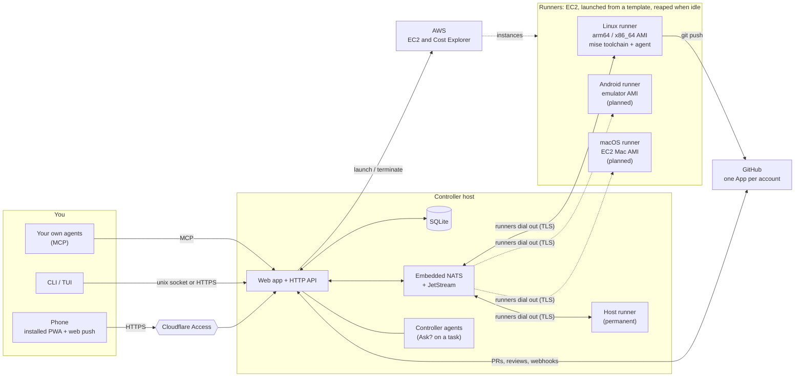

# wrangl

<p align="center"></p>

**W**ork, **R**un, **A**sk, **N**udge, **G**ate, **L**and: put work on a backlog, run it on a
fleet of coding agents, answer what they ask, steer them, gate what they produce, and land it.

wrangl is a self-hosted controller for a fleet of coding agents (Claude Code, Codex, Gemini CLI
and others). You keep one ranked backlog; wrangl runs it on disposable cloud machines, hands you the
questions and the pull requests, and stays out of your way the rest of the time. It is one Go
binary that runs as the **controller** (SQLite, embedded NATS + JetStream, HTTP API) or as a
**runner**, plus the CLI/TUI client. Design:
[`docs/superpowers/specs/2026-10-31-wrangl-design.md`](docs/superpowers/specs/2026-10-31-wrangl-design.md).

<p align="center">
  
  
</p>

## Why yet another metaharness??

Because the agent harnesses are good and getting better, and what's missing is the layer above
them: a backlog, a fleet, and a way to stay in the loop from your phone.

- **Use any coding harness.** The agent is just a command in a runner template. Templates ship for
  Claude Code, Codex, Gemini CLI and Antigravity, so you can mix them and switch as the field moves.
  wrangl never wraps or reimplements the harness; it drives the real CLI in a PTY.
- **One simple binary per host.** Controller, runner, CLI, TUI and MCP server are all the same
  `wrangl` executable. The controller is SQLite plus an embedded NATS: no Postgres, Redis or
  Kubernetes to run. Runners enrol with a token and upgrade themselves.
- **Mobile-first.** An installable PWA with web push makes planning, reviewing and completing
  projects easy from anywhere: triage the inbox, reorder the backlog, approve a merge, or open a
  terminal on a runner, all from a phone.
- **Plan at any granularity.** One ranked hierarchy from release down to task. Queue a whole
  milestone or a single leaf, and agents can split and manage their own subtasks.
- **Your repos, your PRs.** Work lands as ordinary branches and pull requests, with a checkpoint
  commit per subtask and a separate review run. Nothing wrangl-specific ends up in your repo.
- **You only get pulled in when it matters.** Questions, approvals and risky merges arrive in one
  inbox; low-risk work auto-merges.
- **Disposable and cost-aware.** Runners are EC2 instances launched from a template and reaped after
  30 idle minutes. The Runners page shows month-to-date spend, forecast and hourly burn, and lists
  anything else running in the account.
- **Self-hosted, no inbound ports.** It runs in your AWS account and talks to your GitHub through
  Apps you own. Remote access is behind Cloudflare Access, and runners need no inbound access from
  the internet.
- **Drivable by agents too.** Everything in the UI is in the CLI and an MCP endpoint, and "Ask?"
  on a task gets you a controller agent that can propose changes for one-click approval.

## How it fits together

<p align="center"></p>

<details><summary>Text version (Mermaid)</summary>



</details>

The phone talks only to the controller. The terminal you open on a runner, the live backlog and
the inbox all come through it. Runners need no inbound access from the internet: each one enrols with a
one-time token, then dials the controller's NATS (TLS) over the shared VPC. Dashed circles and lines are planned:
only the Linux runner image is built and tested today.

## What it does

**Backlog.** A hierarchical, ranked task stack per project: release > milestone > feature >
task, with dependencies ("needs"), target dates and progress roll-ups. Tasks have types (`code`,
`bug`, `ux`, `architecture`, `docs`, `research`, `review`) that change how the agent is prompted and
what it hands back; `release`, `milestone` and `feature` are planning containers. Pull GitHub issues
in as tasks (`wrangl issue sync`, `issue to-task`). Split a task by hand, or ask an agent to
propose the split and accept it from the inbox.

**Runs.** Queue any task, at any depth, and wrangl runs its subtree.
- It launches a tagged EC2 runner from a **template** (a mise toolchain, a setup script, size
  limits and the agent command), installs it for an unprivileged `agent` user, and terminates it
  after 30 idle minutes. The controller host can enrol itself as a permanent runner.
- The agent runs in a PTY, headless or as one interactive session with optional Remote Control.
  The task card's Live output is the agent's own transcript (tailed on the runner, published over NATS) rendered as Markdown, with the PTY view as a fallback when there is no transcript; the interactive terminals and `wrangl run attach` still show the raw PTY.
  Templates ship for Claude Code, Codex, Gemini CLI and Antigravity.
- Agents manage their own subtasks and ask you things through MCP tools. A checkpoint commit is made
  per subtask. Agents can also search, read, comment on, create and edit GitHub issues of the
  project's linked repos through the controller (they never hold a GitHub credential; closing an
  issue needs your approval).
- When a tool call fails for a reason that is not the agent's fault (for example the GitHub App lacks
  a permission), an Inbox item says so while the run carries on, instead of you finding out when
  the task fails.
- Runners upgrade themselves when the controller does, and template edits roll out to live runners.
- A runner can host several agent sessions at once (each in its own git worktree), projects cap how many instances their demand may launch per template, agents are named definitions separate from templates, and remote runners let an agent drive a Mac or Android target over SSH or ADB.

**Review and merge.** A finished run opens a pull request and a separate review run assesses it.
Low-risk work auto-merges, and the rest waits for you. Each GitHub account gets one App (pushes, opens
and merges PRs, and receives webhooks), created through GitHub's manifest flow when you add the
account on the Setup page. A separate reviewer App is an optional advanced step, only for repos that
require approving reviews. A PR that conflicts with its base branch gets a **Smart Merge** action:
an agent run merges the base in and resolves the conflicts (`wrangl pr resolve`; the project setting
`--auto-resolve` lets auto-merge queue it for you).

**Projects.** The web app is organised by project: the Projects list shows live counts (runners, in
progress, queued, backlog, inbox) per project, and a project page holds its "Needs you" items, the
queue (queue, dequeue, reorder, stop) and backlog, the runners working for it, and a project-level
chat with a controller agent that proposes changes you approve with a button. Design mockups for
these screens are in [`docs/design/`](docs/design/) (one folder per task, each with a README and a
self-contained `prototype.html`); the older `/tasks` and `/project/<slug>` URLs redirect. A finished
project can be archived (hidden everywhere, nothing runs for it) and restored later:
`wrangl project archive|restore`, or the Archive button on the Projects list and project page.

**Inbox.** Agent questions, approvals, plan proposals and deliverables (mockup images, prototype
links, markdown reports) arrive in one place, with web push on the installed app.

**Ask the controller.** "Ask?" on any task starts a thread with a lightweight controller agent (the
installed `claude` CLI on the controller host, boxed to read tools and the `wrangl` CLI). It sees the
task and its subtree, can reach other tasks through the CLI, and replies with up to five
one-click proposed actions (add a task, move tasks between parents, split, queue, and so on) that
run only when you approve them.

**Fleet and cost.** The Runners page shows live and recent runners, a web terminal on each (one tab
per agent session, plus shells), and AWS spend: month to date, forecast, hourly burn, and a breakdown
of what is in "EC2 - Other". Instances wrangl didn't launch are listed so you can adopt or
terminate them. The Logs page merges runs with runner, template and upgrade events.

**Interfaces.** An installable mobile PWA (Datastar, no build step), the `wrangl` CLI, a TUI, and an
MCP endpoint (`wrangl mcp`) so your own agents can read and edit the backlog. Remote access sits
behind Cloudflare Access, and on the controller host the CLI uses a unix socket with no auth.

**Web UI convention.** Client state lives in Datastar signals or HTML attributes, never in hand-written
JS, because every live update morphs `#main` from server HTML and clobbers anything the page set
itself. Use `data-preserve-attr="open"` on every `<details>` and modal `<dialog>`; `command="show-modal"`
/ `command="close"` with `commandfor` for sheets; `popover` / `popovertarget` for menus;
`data-signals`, `data-class`, `data-show`, `data-attr` and `data-bind` for toggles, selection and
form state (`data-class` re-applies itself after a morph; `data-show` does not, so use a class). No
inline `onclick`/`onchange`/`onsubmit`. Documented exceptions: the Back button, `enablePush`,
and `ghManifest` on the setup forms. The expanded task card is the `$open` signal (the title posts
`/ui/expand`, and the server puts that card in every live render); the lightbox is a `<dialog>` in
each gallery driven by `$lbi`. `static/app.js` keeps what has
no HTML equivalent: Sortable drag and drop, terminals, web push, the service worker, the
inline confirm, and the card's live output. `static/keys.js` is keyboard handling only (a chorded
list navigator does not fit `data-on:keydown__window`); the state it drives is signals. Each such
behaviour has a live-patch check in `cmd/wrangl/internal/e2e/browser/livepatch.js` (open the thing, inject a
probe into `#main`, cause an event, confirm the probe is gone and the state kept); run it with
`PLAYWRIGHT_DIR=<dir with node_modules/playwright> go test ./cmd/wrangl/internal/e2e -run TestLivePatch`.

Status: **M1 to M10 built**, tested against fakes for AWS, GitHub and the agents. See the install
guide's first-run checklist for what still needs a real account.

## Install and run

Start at the documentation index, [`docs/wrangl/README.md`](docs/wrangl/README.md): install, first project,
first task, the Inbox, and deep-dive guides on [projects](docs/wrangl/guide/projects.md),
[tasks](docs/wrangl/guide/tasks.md), [runners](docs/wrangl/guide/runners.md) and
[task scheduling](docs/wrangl/guide/scheduling.md).

[`docs/wrangl/INSTALL.md`](docs/wrangl/INSTALL.md) covers AWS, the controller host, the GitHub Apps,
the Claude token, templates, Cloudflare, and teardown. AWS setup (instance roles, security group,
teardown): [`docs/wrangl/aws-iam.md`](docs/wrangl/aws-iam.md). Template examples are in
[`docs/wrangl/templates/`](docs/wrangl/templates/), and the agent skill that teaches Claude to drive
the CLI is in [`docs/wrangl/skill/`](docs/wrangl/skill/).

```sh
task build-wrangl      # build/wrangl + build/wrangl-linux-{aarch64,x86_64}
task sqlc              # regenerate cmd/wrangl/internal/db/dbgen after editing SQL
task sqlc-check        # fail if dbgen is stale

build/wrangl --config ./c.yaml controller init --data-dir ./data
build/wrangl --config ./c.yaml controller serve
curl --unix-socket /run/wrangl/api.sock http://x/healthz

build/wrangl template create -f template.yaml
build/wrangl fleet launch --template go-claude     # tagged EC2 instance, enrols itself
build/wrangl fleet list
build/wrangl task tree my-project                  # the ranked backlog
build/wrangl task ask SQID "Any concerns?" --wait  # ask a controller agent
build/wrangl fleet teardown                        # terminate every tagged instance
```

The logo and icons are built from `docs/brand/source.jpg` by `docs/brand/make-logo.py`, and the
architecture diagram by `docs/brand/make-architecture.py`; see
[`docs/brand/`](docs/brand/README.md).

---

## Also in this repo: ssm

A separate single-binary tool, `ssm`, for connecting to, tunnelling into and provisioning EC2 instances
via AWS SSM and EC2 Instance Connect. Build it with `task build`; see `ssm --help` and
[`docs/superpowers/specs/2026-06-26-ssm-tool-design.md`](docs/superpowers/specs/2026-06-26-ssm-tool-design.md).
