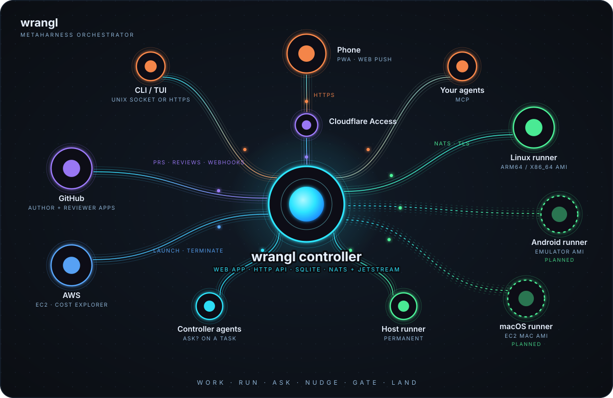
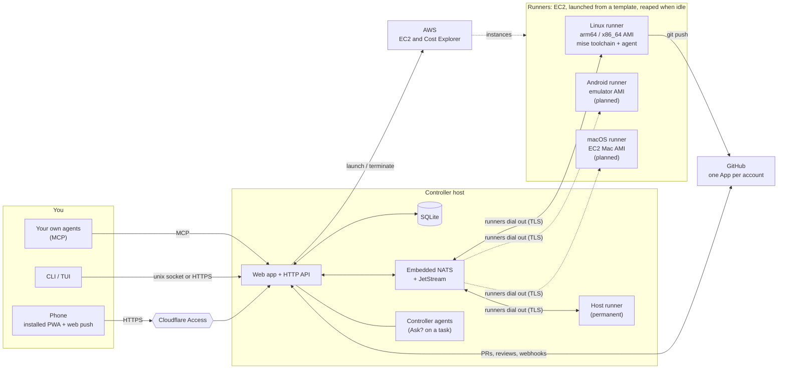

# wrangl design overview

How wrangl fits together and what each part does. The README has the short version; the decisions
behind it are in [`adr/`](adr/), and the original specification is
[`docs/superpowers/specs/2026-10-31-wrangl-design.md`](../superpowers/specs/2026-10-31-wrangl-design.md).
For the objects you work with, read the guides: [projects](guide/projects.md), [tasks](guide/tasks.md),
[runners](guide/runners.md) and [task scheduling](guide/scheduling.md).

## How it fits together

Text version (Mermaid)

The phone talks only to the controller. The terminal you open on a runner, the live backlog and
the inbox all come through it. Runners need no inbound access from the internet: each one enrols with a
one-time token, then dials the controller's NATS (TLS) over the shared VPC. Dashed circles and lines are planned:
only the Linux runner image is built and tested today.

## What it does, in depth

**Backlog.** A hierarchical, ranked task stack per project: release > milestone > feature >
task, with dependencies ("needs"), target dates and progress roll-ups. Tasks have types (`code`,
`bug`, `ux`, `architecture`, `docs`, `research`, `review`) that change how the agent is prompted and
what it hands back; `release`, `milestone` and `feature` are planning containers. Pull GitHub issues
in as tasks (`wrangl issue sync`, `issue to-task`). Split a task by hand, or ask an agent to
propose the split and accept it from the inbox.

**Runs.** Queue any task, at any depth, and wrangl runs its subtree.
- It launches a tagged EC2 runner from a **template** (a mise toolchain, a setup script, size
  limits and the agent command), installs it for an unprivileged `agent` user, and terminates it
  after 30 idle minutes. The controller host can enrol itself as a permanent runner.
- The agent runs in a PTY, headless or as one interactive session with optional Remote Control.
  The task card's Live output is the agent's own transcript (tailed on the runner, published over NATS) rendered as Markdown, with the PTY view as a fallback when there is no transcript; the interactive terminals and `wrangl run attach` still show the raw PTY.
  Templates ship for Claude Code, Codex, Gemini CLI and Antigravity.
- Agents manage their own subtasks and ask you things through MCP tools. A checkpoint commit is made
  per subtask. Agents can also search, read, comment on, create and edit GitHub issues of the
  project's linked repos through the controller (they never hold a GitHub credential; closing an
  issue needs your approval).
- When a tool call fails for a reason that is not the agent's fault (for example the GitHub App lacks
  a permission), an Inbox item says so while the run carries on, instead of you finding out when
  the task fails.
- Runners upgrade themselves when the controller does, and template edits roll out to live runners.
- A runner can host several agent sessions at once (each in its own git worktree), projects cap how many instances their demand may launch per template, agents are named definitions separate from templates, and remote runners let an agent drive a Mac or Android target over SSH or ADB.

**Review and merge.** A finished run opens a pull request and a separate review run assesses it.
Low-risk work auto-merges, and the rest waits for you. Each GitHub account gets one App (pushes, opens
and merges PRs, and receives webhooks), created through GitHub's manifest flow when you add the
account on the Setup page. A separate reviewer App is an optional advanced step, only for repos that
require approving reviews. A PR that conflicts with its base branch gets a **Smart Merge** action:
an agent run merges the base in and resolves the conflicts (`wrangl pr resolve`; the project setting
`--auto-resolve` lets auto-merge queue it for you).

**Projects.** The web app is organised by project: the Projects list shows live counts (runners, in
progress, queued, backlog, inbox) per project, and a project page holds its "Needs you" items, the
queue (queue, dequeue, reorder, stop) and backlog, the runners working for it, and a project-level
chat with a controller agent that proposes changes you approve with a button. Design mockups for
these screens are in [`docs/design/`](../design/) (one folder per task, each with a README and a
self-contained `prototype.html`); the older `/tasks` and `/project/<slug>` URLs redirect. A finished
project can be archived (hidden everywhere, nothing runs for it) and restored later:
`wrangl project archive|restore`, or the Archive button on the Projects list and project page.

**Inbox.** Agent questions, approvals, plan proposals and deliverables (mockup images, prototype
links, markdown reports) arrive in one place, with web push on the installed app.

**Ask the controller.** "Ask?" on any task starts a thread with a lightweight controller agent (the
installed `claude` CLI on the controller host, boxed to read tools and the `wrangl` CLI). It sees the
task and its subtree, can reach other tasks through the CLI, and replies with up to five
one-click proposed actions (add a task, move tasks between parents, split, queue, and so on) that
run only when you approve them.

**Fleet and cost.** The Runners page shows live and recent runners, a web terminal on each (one tab
per agent session, plus shells), and AWS spend: month to date, forecast, hourly burn, and a breakdown
of what is in "EC2 - Other". Instances wrangl didn't launch are listed so you can adopt or
terminate them. The Logs page merges runs with runner, template and upgrade events.

**Interfaces.** An installable mobile PWA (Datastar, no build step), the `wrangl` CLI, a TUI, and an
MCP endpoint (`wrangl mcp`) so your own agents can read and edit the backlog. Remote access sits
behind Cloudflare Access, and on the controller host the CLI uses a unix socket with no auth.

## Status

Status: **M1 to M10 built**, tested against fakes for AWS, GitHub and the agents. See the install
guide's first-run checklist for what still needs a real account.
