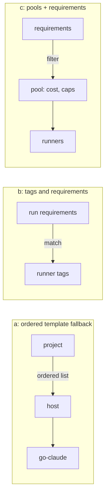
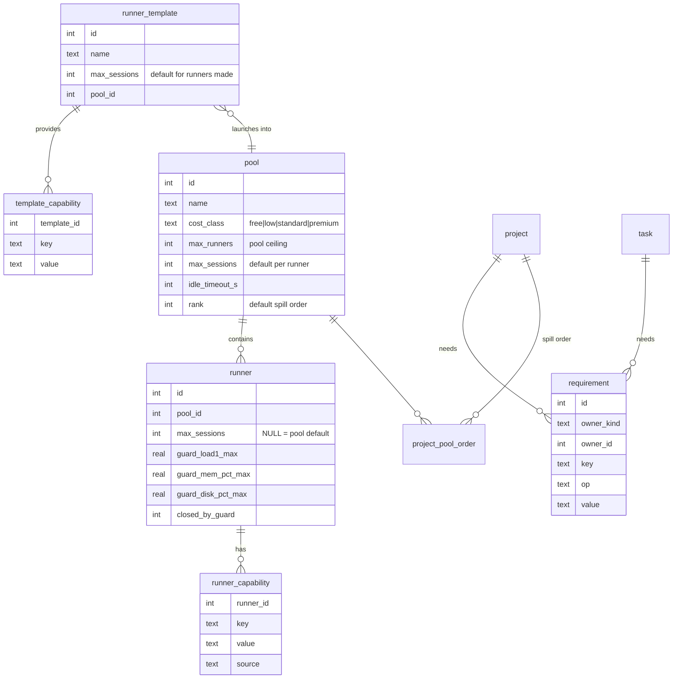
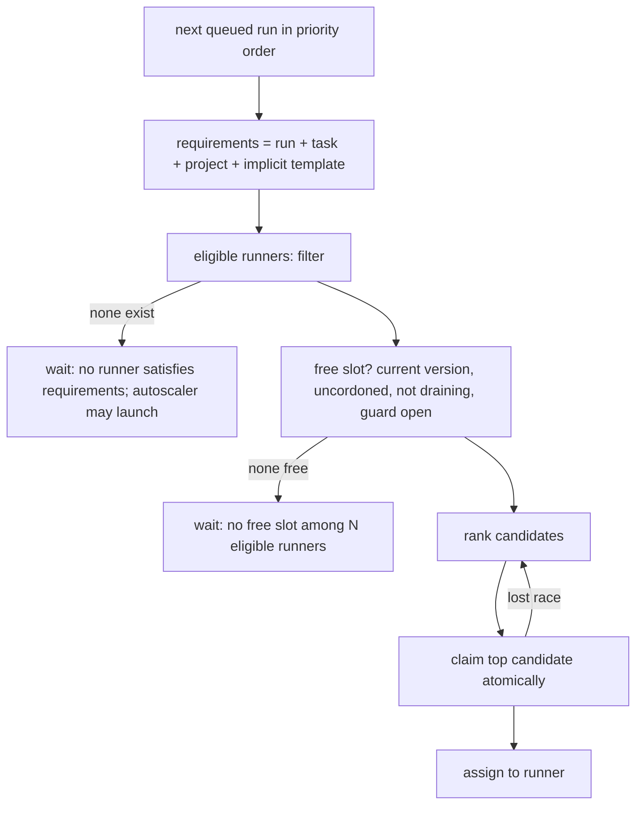

# ADR 0007: Capabilities vs capacity, and capability-based placement

- Status: **Accepted, not built; slots, pools and count caps superseded by [ADR 0009](0009-resource-based-placement.md) (Proposed).** The capability-tag half (sections 2 to 4 tags/requirements, stage 2) and the measured host guard survive; session slots, pools and cost classes, per-template and per-project count caps, and the ordered fallback (stage 1) are replaced by resource needs and an hourly budget. Read 0009 first.
- Task: fywVRL
- Builds on: [ADR 0002](0002-remote-runners.md), [ADR 0008 (runners belong to the system)](0008-runners-belong-to-the-system.md); migrations 00020 (`max_sessions`), 00025 (`project_template_limit`, `runner.launched_for_project`), 00027 (remote targets)
- Touches (future work): `controller/scheduler/{assign,scheduler}.go`, `db/queries/{run,runner}.sql`, `controller/fleet/{template,templates_apply}.go`, `web/views_runners.go`, project settings screen, `cli/{template,fleet}.go`, `proto` (heartbeat is reused), migrations 00037+

Design only; no application code changes with this ADR. All paths are under `cmd/wrangl/internal/`.

## 1. Context

### 1.1 What the code does today (verified by reading it)

1. **A run is bound to one template at queue time.** `COALESCE(run.template_id, task.template_id, project.default_template_id)` appears in `QueuedRunsForAssignment`, `TemplateDemand` and `ProjectTemplateDemand` (`run.sql`, `runner.sql`). `scheduler.Assign` skips runs with no template. `assignOne` passes that id (or the driver's, for remote templates) to `FreeRunnerSlot` and `ClaimIdleRunner`, whose `WHERE n.template_id = ?` considers only that template. There is no fallback to another runner. *Verified.*
2. **`runner_template` mixes two concerns.**
   - Capability: `arch`, min vCPU/RAM/disk, `instance_types`, `ami`, `mise_toml`, `setup_script`, the `agent` block and `agents:` allow-list, mode/connection (`fleet.TemplateFile`).
   - Capacity and cost: `max_sessions`, `max_runners`, `idle_timeout`, plus the per-project `project_template_limit.max_instances`.
3. **Autoscaling (`Scheduler.Tick`)**, per template: `need = demand - supply` (`TemplateDemand`), `hosts = ceil(need / max_sessions)`, `n = min(hosts, max_runners - live)`, then `PlanLaunches` splits among projects in `priority DESC` order, each limited by `EffectiveCap(stored, isDefault, max_runners) - live` where `live` counts `runner.launched_for_project`. Skips: `failed_version == version`, per-template backoff (1m to 30m), and 3 never-enrolled runners within 1h. Idle reaping is `ReapCandidates` (`launched = 1` only, `idle_since` older than `idle_timeout_s`). *Verified.* One correction: `EffectiveCap` gives a default of 1 for the project's default template and **0 for every other template**, so a project cannot spill to a non-default template unless someone set a limit. That is the real reason for the host problem below, not only the runner query.
4. **The controller host runner** is created by `CreateAdoptedRunner` (`launched = 0`), so it is never launched or reaped. It is a runner of template `host`. Because placement is by template id, only projects whose effective template is `host` ever use it. The `wrangl` project (default `go-claude`, limit `go-claude=1`, `host=0`) therefore always makes the autoscaler launch a paid runner while the host idles at about 6% CPU. *Verified from the queries; the 8 vCPU / ~31 GiB / ~6% CPU / disk 71% / RAM 58% numbers are the task's measurements and were not re-measured.*
5. **Session slots.** Slot use is `COUNT(run)` on the runner in states `assigned, preparing, running, needs_input, pushing, cancelling`, compared with `t.max_sessions`. The cap is read from the template, not the runner. *Verified.*
6. **Only CPU, RAM and disk are real host limits.** The runner already publishes `Heartbeat{CPUPercent, MemPercent, DiskPercent, Load1}` (`proto/proto.go`), stored in `runner.last_metrics_json`. Nothing in placement reads it. *Verified.*

### 1.2 Two points the task asked to check

**Version-mismatched runners can stall a run.** `TemplateDemand.supply` counts a runner's free slots whenever it is `idle/busy/launching/enrolling/provisioning`, uncordoned and not draining, regardless of `template_version`. `ClaimIdleRunner` and `FreeRunnerSlot` require `n.template_version = t.version`. A runner behind its template is reapplied by `reconcileTemplate`, but `StartProvisioning` only accepts `enrolling`/`idle` (or a stale `provisioning`). Consequences:

- A **busy** runner behind the template is supply that nobody can claim, until its last session ends and it turns idle. While it is busy the autoscaler sees no unmet need and launches nothing, and `Assign` skips every new run. Long sessions (or `needs_input` waits, see below) make this a real stall of minutes to hours. *Inferred from the SQL; no test covers it.*
- If the apply **fails**, `TemplateFailed` cordons that runner and sets `failed_version`. Other runners of the template still count as supply, and `Tick` refuses to launch while `failed_version == version`. Queued runs then wait indefinitely until the owner edits the template. Intended as a safety brake, but nothing says so on the run.
- The host runner is subject to the same thing after a template edit.

Fix (in this design): supply counts only runners that are claimable now or will be claimable without owner action (current version, or `launching/enrolling/provisioning`). A runner behind its version counts as 0 supply and the run's reason string says so.

**`needs_input` holds a slot and a worktree.** It is in the active-state list, so it keeps counting. `blocked` is a terminal run state in this schema (`run.sql` excludes it with `succeeded/failed/cancelled`), so blocked runs do **not** hold a slot. Only `needs_input` is affected. Today a runner can sit at full `max_sessions` with all agents waiting on a human. Recommendation (section 7.4): it keeps holding the worktree and disk but should stop counting as a *session slot* after a grace period, because it burns no CPU. The decision is the owner's (section 12).

## 2. Vocabulary

Each term is defined once; the rest of the document uses them exactly.

- **Capability**: a fact about what a runner can do: arch, toolchains installed, agent CLIs and authentication present, network reach, GPU, whether it is a remote-target driver. Stored as a set of `key=value` tags.
- **Requirement**: what a project, task or run needs, expressed against capabilities (`arch=arm64`, `agent:claude`, `tool:go>=1.22`). A set of requirements is a **requirement set**.
- **Capacity**: how much work a runner or pool can take at once and what it costs: session slots, optional host headroom (CPU/RAM/disk), a ceiling on instance count, a **cost class**.
- **Template**: a recipe for building and provisioning a runner (AMI, instance types, mise config, setup script, agent block). It *declares* the capabilities it provides and the capacity defaults of runners it makes. It is not a placement key any more.
- **Runner**: one machine running the wrangl daemon (`runner` row), launched from a template or adopted (the host). It owns capability tags (copied from its template at launch, plus manual ones) and capacity values.
- **Session slot**: one concurrent agent session on a runner. Counted as active runs on it; see section 7.4 for which states count.
- **Pool**: a named group of runners with shared capacity limits and one cost class, produced by one or more templates. The host is the pool `host`. A pool is the unit the autoscaler launches into and the unit on which global caps apply.

## 3. Alternatives



**(a) Keep templates; add an ordered fallback list per project.** `project_template_order(project_id, rank, template_id)`. `assignOne` tries each template in order; the autoscaler launches only when all earlier ones are full.
- Pros: small; fixes the headline `wrangl` project; no new concepts; trivial migration.
- Cons: still names templates, so a task that needs "arm64 + claude" must know which templates qualify; every new template requires editing every project; cost and caps stay per template; nothing expresses "this task needs GPU"; the autoscaler still plans per template and cannot choose between two templates that both satisfy a need.

**(b) Capability tags on runners, requirements on projects and tasks (declarative matching).**
- Pros: placement describes intent, not machines; new runners join automatically; supports tasks with unusual needs; natural fit for target+driver (requirements `driver:ssh`).
- Cons: with no notion of cost or caps it cannot say "prefer the host, then the cheap pool"; "cheapest first" would need cost as a tag, which is a hack; autoscaling still needs a template choice rule; tag vocabulary can drift (typos silently match nothing, so needs validation and the reason string).

**(c) Pools with capacity and cost per pool; requirements matched to pools.**
- Pros: models cost and caps cleanly (global cap, per-class cap, spill order = cost order); the autoscaler plans per requirement set and picks the cheapest pool that satisfies it; host is just a pool with a measured guard.
- Cons: biggest change; two new concepts (pool, requirement); pools without capability matching are just templates renamed, so (c) alone either needs (b) underneath or degenerates into (a).

**Recommendation: (b) and (c) combined, delivered through (a) as the first step.** Capabilities are tags on runners (b), because placement must be able to say what a run needs. Cost and caps belong to pools (c), because the question "host first, then the cheapest launched runner" is about price, not skills. Ordered fallback (a) is *not* the destination but is stage 1: it is the smallest change that stops the `wrangl` project paying for a runner while the host idles, and its table (`project_template_order`) is retired in stage 3 when ranking by cost class replaces it. We pick this over (a) alone because (a) bakes template names into every project and cannot grow; over (b) alone because it has no price; over (c) alone because pool membership without requirements cannot reject a runner that lacks claude auth.

## 4. Data model



Migration 00037 onwards (one migration per stage, each with a down section like existing ones):

| Stage | Table / column | Notes |
|---|---|---|
| 0 | `runner.max_sessions INTEGER NULL`, `runner.guard_*` columns (`guard_load1_max REAL`, `guard_mem_pct_max REAL`, `guard_disk_pct_max REAL`), `runner.closed_by_guard INTEGER NOT NULL DEFAULT 0` | NULL guard = off. Nothing reads them yet except display. |
| 1 | `project_template_order(project_id, rank, template_id, PRIMARY KEY(project_id, template_id))` | Empty = today's behaviour. |
| 2 | `template_capability(template_id, key, value)`, `runner_capability(runner_id, key, value, source CHECK IN ('template','probe','manual'))`, `requirement(owner_kind CHECK IN ('project','task','run'), owner_id, key, op CHECK IN ('=','>=','in','exists'), value)` | Tags are `key=value`; `arch=arm64`, `tool:go=1.22`, `agent:claude=authed`, `net=public`, `gpu=none`, `role=driver`. Requirement keys are validated against known keys plus those present on any template. |
| 3 | `pool(id, name UNIQUE, cost_class, max_runners, max_sessions, idle_timeout_s, rank)`, `runner_template.pool_id`, `runner.pool_id`, `pool_global_cap(cost_class, max_runners)`, `project_pool_cap(project_id, pool_id, max_runners)` | Replaces `project_template_limit`, to be removed in stage 4. |

**Existing templates.** They stay and still define provisioning. In stage 2 every template's `arch`, `agents:` allow-list and mise tools are *derived* into `template_capability` (and copied to `runner_capability` with `source='template'` when a runner enrols or reapplies). In stage 3 each template gets a pool: one pool per template named after it (`go-claude`, `host`), carrying its current `max_runners`, `max_sessions`, `idle_timeout`; cost class `free` for the adopted host, `standard` for launched. Template YAML keeps working; new optional keys are `provides:` (extra tags), `pool:`, and `cost_class:`.

**Day-one no-behaviour-change migration.** For every project, the implicit requirement set is "the effective template", expressed as `template=<name>` (a reserved tag every runner carries, from `runner.template_id`). Existing `run.template_id` / `task.template_id` / `project.default_template_id` keep working and are translated to this requirement at match time. The migrations create no new requirements for anyone, so matching behaves exactly like `n.template_id = ?` until an owner adds a fallback (stage 1) or real requirements (stage 2). `project_template_limit` rows are read unchanged until stage 4; `launched_for_project` stays populated.

## 5. Placement algorithm

Replaces the `ClaimIdleRunner(template)` call inside `assignOne`. `Assign` still iterates `QueuedRunsForAssignment` in order, so **project priority and `queue_rank` apply unchanged**: `ORDER BY p.priority DESC, (r.queue_rank IS NULL), r.queue_rank, t.rank, r.queued_at`. Placement is per run, in that order; a higher-ranked run claims a slot first. A later, lower-priority run is never allowed to take a slot a higher-ranked run was eligible for, because ranked runs are processed first within one `Assign` pass.



Steps for one run:

1. **Resolve requirements.** Union of run, task and project requirements (a task may narrow, never widen, what its project allows; see open question Q4) plus, until stage 2 completes, the implicit `template=<effective template>`; with stage 1 the implicit requirement is `template in (ordered list)`. Agent resolution (`resolveAgent`) happens first as today, since the chosen agent adds `agent:<name>` as a requirement: a runner whose host lacks claude auth is filtered, not tried and failed.
2. **Filter** runners by: `state IN ('idle','busy')`, `cordoned = 0`, `drain_requested = 0`, `upgrade_sha = ''`, **template version current** (as today), `closed_by_guard = 0`, and every requirement satisfied by `runner_capability`. Count the survivors-before-slot-check as *N eligible runners* for the reason string.
3. **Free slot check**: `active_sessions(runner) < COALESCE(runner.max_sessions, pool.max_sessions)` where `active_sessions` counts the states of section 7.4.
4. **Rank** the candidates by, in order:
   1. already-owned runner with a free slot before any not-yet-running capacity. Because only existing runners are candidates, this is "use what we have first"; launching happens only in the autoscaler;
   2. lowest **cost class** (`free` < `low` < `standard` < `premium`), then the project's own `project_pool_order.rank` if set (stage 3 spill order), then pool `rank`;
   3. **packing**: busiest runner with room first (as `ORDER BY (n.state='busy') DESC` today), then longest idle.
5. **Claim** the top candidate with a conditional `UPDATE ... WHERE id = ? AND slots-free` (a variant of `ClaimIdleRunner` that takes a runner id); on zero rows try the next candidate. This preserves today's single-claim-then-`AssignRun` flow and the `release()` rollback.
6. **Spill order** is the cost-class-then-rank ordering of step 4.2: the host (`free`) is used until full or closed by the guard, then cheaper-first launched pools. In stage 1 it is literally `project_template_order.rank`.
7. **Remote templates.** See section 8.
8. **If no candidate**, set `run.status_text` to the reason (section 5.1) and leave the run queued. `Assign` already uses `SetRunStatus` for held-back reasons (`resolveAgent`, `mintToken`); this generalises it. The reason is rewritten only when it changes, so the UI does not churn.

### 5.1 Reason strings

Built from counts gathered in steps 2 and 3, in this precedence:

- `waiting: no runner satisfies agent:claude, tool:go>=1.22 (launching one)` or `(limit reached: pool go-claude 2/2)`
- `waiting: no free slot among 3 eligible runners (host 4/4, go-claude-1 4/4, go-claude-2 4/4)`
- `waiting: host lacks claude auth; 2 launched runners are at capacity`
- `waiting: host closed by load guard (load1 7.9 > 6.0); go-claude at 4/4`
- `waiting: runner go-claude-1 is behind template v7 (v6); applying when idle`
- `waiting: cordoned: go-claude-3`
- `waiting: launch paused: go-claude failed to apply v7 (fix: wrangl template edit go-claude)`

Plain, owner-actionable, capped at the existing 300 chars.

## 6. Autoscaler

`Tick` is rewritten to plan per **requirement set** instead of per template:

1. **Demand**: group queued runs by their resolved requirement set (a canonical sorted string, hashed). Unlike today's `TemplateDemand` this also includes the implicit `template=` set, so day one is identical.
2. **Supply per set**: free slots on runners that *satisfy the set and are claimable or becoming claimable* (current version; `launching/enrolling/provisioning` count fully, as now; version-behind and guard-closed runners count zero). `need = demand - supply`. If `need <= 0` do not launch: this is the "do not launch while eligible free slots exist elsewhere" rule, and now covers the host and other pools, not only the one template.
3. **Choose a pool/template** that satisfies the set: among templates whose `template_capability` covers the set, drop those whose pool is full (pool `max_runners`, `pool_global_cap` for the cost class, `project_pool_cap`), whose version failed (`failed_version == version`), or which are in backoff; take the lowest cost class, then rank. If none: no launch and the run's reason names the blocker.
4. **Size**: `hosts = ceil(need / max_sessions)`, bounded by the room under all caps. Caps are checked in this order: pool ceiling, global cost-class cap, per-project cap (via `PlanLaunches`, kept as is, now keyed by pool and fed by `project_pool_cap`). A project at its cap does not push demand onto the next project, unchanged.
5. **Projects**: `PlanLaunches` keeps the highest-priority-first split. `runner.launched_for_project` stays as launch attribution for caps. (Its weakness, noted in ADR 0008, is unchanged; replacing it with usage-based accounting is out of scope.)
6. **Backoff** and the enrolment-failure brake keep their per-template keys (`backoff`, `askedStuck`, `CountFailedEnrolments`), since failure is a property of a recipe, not of a pool.
7. **Idle reaping** is unchanged in mechanism (`ReapCandidates`), with `idle_timeout_s` read from the pool when set, else the template. Adopted runners (`launched = 0`, the host) are never reaped.
8. **Remote templates**: unchanged in shape (`tickRemote`); see section 8.

## 7. Host capacity

### 7.1 Slots and guard
The host gets `runner.max_sessions` (e.g. 6 on this box, an explicit override of the pool/template default) and three optional thresholds: `guard_load1_max`, `guard_mem_pct_max`, `guard_disk_pct_max`.

### 7.2 Measured guard
A new `fleet.EvaluateGuard(runner, hb)` runs on every heartbeat (the same hook as `reconcileTemplate`). It compares `Heartbeat.Load1`, `MemPercent`, `DiskPercent` with the runner's thresholds, using hysteresis (close at the threshold, reopen at 90% of it, and after at least 2 consecutive samples, to avoid flapping on one spike). It sets `runner.closed_by_guard`. Placement filters on `closed_by_guard = 0`; supply counts it as zero. Suggested starting values for this box, from the measured figures: `load1 <= 0.75 * vCPU` (6.0), `mem_pct <= 85`, `disk_pct <= 85` (disk was already at ~71%, so disk is the real limit; the guard must not let sessions fill it).

### 7.3 When the guard trips mid-run
Existing sessions are **never killed or paused** by the guard: it only closes the runner to *new* assignments (as with cordon). A closed host stays visible as `host: closed (disk 87% > 85%)`. Runs queue and spill to launched pools. If disk stays over the threshold with no new sessions, an owner action is needed; a later, optional step may clean finished worktrees, but that is out of scope here. A guard condition that is missing (no heartbeat, offline) already marks the runner offline, which removes it from candidates.

### 7.4 Which states count as a session slot
Today: `assigned, preparing, running, needs_input, pushing, cancelling`. Proposed: keep all, **except** `needs_input` for more than `needs_input_slot_grace` (default 10 minutes). After the grace the run no longer counts toward `max_sessions` but still counts toward disk (worktree) and a separate `max_parked` per runner (default 4) so a pile of waiting agents cannot exhaust the disk. Resuming a run whose slot was released needs a slot; if none is free, it waits (the reason says so). *This changes behaviour and ships last (stage 4), behind a per-pool setting default `off`.* `blocked` is terminal and already frees the slot; the task statement's "blocked runs" is covered by that.

## 8. Remote templates (targets)

A remote template (`template_connection.mode = 'remote'`) describes a target machine that runs no wrangl; the agent runs on a *driver* runner and drives it (`claimTarget`). A run on such a template needs two things at once: a free **target** (`RemoteTarget` via `ClaimTarget(template)`) and a free **session slot on a driver**. The design keeps this exactly two-resource:

- Requirements split in two scopes: `target.*` requirements select among remote target templates (e.g. `target.os=macos`); everything else applies to the **driver** runner. The driver also needs `role=driver` (or `protocol:ssh`), derived from the connection's `driver_template`; stage 1/2 simply keep `driver_template_id` as the fixed driver pool, and stage 3 relaxes it to "any pool whose runners satisfy the driver requirements".
- Placement: claim the target first (as now), then place the driver session by steps 2 to 6. If the driver step fails, release the target (the `release()` closure already unbinds). Reason strings name which resource is missing: `waiting: target mac-mini 1/1 busy` vs `waiting: no free driver slot`.
- Autoscaler: unchanged split. `tickRemote` launches targets within per-project caps; driver demand is added to the driver requirement set (as `driverDemands` does today), and the project target cap still bounds how many drivers are useful.
- Cost: targets belong to their own pool and cost class (mac instances are the expensive ones; `fleet.CostWarning` stays).

## 9. UI and CLI

**Runner settings screen** (project settings and Runners page; mock in text):

```
Runners
  Host pool        wrangl-host          free        sessions [ 6 ]   guard load [ 6.0 ] mem [ 85 ]% disk [ 85 ]%   ● open
  Extra pools, in spill order (drag to reorder)
    1. go-claude   standard   up to [ 2 ] runners   [ 4 ] sessions each
    2. go-big      premium    up to [ 0 ] runners
  This project needs   [ tool:go ] [ agent:claude ] [+ add]
  Why isn't it running?  see each queued run's line below
```

- Host first, then ordered extra pools (stage 1: this is a drag-reorder list of templates writing `project_template_order`; stage 3: a list of pools with caps writing `project_pool_cap`/`project_pool_order`). Implemented in `web/views_runners.go` (the runner card already has `Used` and `T.MaxSessions`; it will use effective capacity) and the project settings view (where the current per-template limit editor lives).
- **Run line**: the run page and Queue row show `status_text` (already rendered for held-back runs) with the section 5.1 strings.
- `wrangl template show <name>` prints a **Capacity** block: max sessions, max runners, idle timeout, pool/cost class, live/free slots, and (stage 2+) **Provides** tags.
- `wrangl fleet list/show` (`cli/fleet.go`, which already prints `applied vX of vY`) adds a `TAGS` column (`arm64 go claude`) and a `SLOTS 2/4` column, `closed:load` in the state column when the guard holds a runner, and the behind-version marker already there.
- `wrangl project edit --limit tmpl=N` keeps working through stage 3, prints a deprecation notice from stage 3, and is removed in stage 4. New: `--fallback host,go-claude` (stage 1), `--need agent:claude` (stage 2).

## 10. Observability and tests

**Logging.** One `slog.Info("placement", ...)` per decision attempt where the outcome changes (placed or waiting reason changed), with: `run`, `task`, `project`, `requirements`, `eligible` (count), `free` (count), `chosen` (runner/pool), `rank_reason` (cost_class, packing), `waiting` (reason code). The autoscaler logs one `slog.Info("autoscale")` per requirement set per tick where it launched or declined: `set`, `demand`, `supply`, `need`, `pool`, `hosts`, `blocked_by` (pool cap/global cap/project cap/backoff/failed_version). Both also increment counters in the existing fleet "notes" feed when something needs the owner (as `OnLaunchStuck` does).

**Scenarios the suite must cover** (in `scheduler/scheduler_test.go`, using the fake clock/GitHub already there):

| # | Scenario | Expected |
|---|---|---|
| 1 | Host idle, project has host in its allowed list | Run goes to host; no launch. |
| 2 | Host full (4/4), go-claude allowed | Run spills to launched go-claude runner; if none exists, one launch is planned, but only after host is full. |
| 3 | Host guard tripped (load/disk), mid-run | Existing sessions untouched; new run not placed on host; reason `host closed by load guard`; reopens after hysteresis. |
| 4 | Runner behind `template_version`, busy | Counts 0 supply; run waits with `behind template` reason; after idle+apply it is placed. Regression for the stall in 1.2. |
| 5 | Version failed (`failed_version`) | No launch; reason names the template; other eligible runners still used. |
| 6 | Cordoned / draining runner | Never a candidate; not supply; reason lists it. |
| 7 | Two projects compete for one free slot | Higher `priority` wins; within one, `queue_rank` order; loser gets `no free slot`. |
| 8 | Project at its cap, other project not | Autoscaler does not push the capped project's demand to the other (`PlanLaunches` unchanged). |
| 9 | Requirement not met anywhere (`agent:claude`, host lacks auth) | Run filtered from the host, placed elsewhere or waits with `host lacks claude auth`. |
| 10 | Target plus driver | Both claimed or neither; driver full releases the target; reason distinguishes the two. |
| 11 | Day-one equivalence | With no fallback/requirements, results are identical to current `ClaimIdleRunner` for a table of existing fixtures (property test run against both implementations until stage 4). |
| 12 | `needs_input` grace (stage 4) | Slot freed after the grace, parked limit enforced, resumed run waits if full. |
| 13 | Free slots elsewhere | Autoscaler does not launch while an eligible pool has free slots. |

## 11. Staging

Each stage ships alone and is safe if later stages never land.

### Stage 0: visibility and fields (no behaviour change)
- **Scope**: set a waiting reason on runs when `assignOne` returns `sql.ErrNoRows` (`FreeRunnerSlot` returns 0 or no runner), with N eligible runners and current counts; `wrangl template show` prints capacity; new runner columns `max_sessions`, `guard_*` (migration 00037), unused except in `runner show`/runner card display.
- **Migration**: additive nullable columns.
- **Verify**: run waits show a reason in UI and `wrangl run show`; golden test of `template show`; full existing test suite unchanged.
- **Rollback**: revert code; columns are inert (down migration drops them).
- **Unlocks**: the owner sees why runs wait before anything changes; reason strings used by every later stage.

### Stage 1: per-project ordered fallback of templates
- **Scope**: `project_template_order`; `assignOne` iterates the ordered list calling `FreeRunnerSlot`/`ClaimIdleRunner` per template; `Tick` computes per-project demand for the first template in the list that still has free slots and launches only when all earlier ones are full; `EffectiveCap` is consulted for the template actually launched; fix supply to ignore version-behind runners. UI: ordered list in project settings; `wrangl project edit --fallback host,go-claude`.
- **Migration**: new table, empty. Empty list = today. Then set `wrangl: host, go-claude` as a deliberate owner action.
- **Verify**: scenarios 1, 2, 4, 6, 7, 11 plus an end-to-end on a dev controller with the host runner.
- **Rollback**: delete the project's rows (or revert); behaviour returns to single-template.
- **Unlocks**: the `wrangl` project uses the idle host immediately.

### Stage 2: capability tags and requirement sets
- **Scope**: tag tables, template `provides:`, probe of runner facts at enrol (arch, tools, agent auth presence reported in the enrol/heartbeat payload), requirement parsing and validation (`fleet/template.go`, new `placement` package), matching in a new `ClaimRunnerFor(requirements)` query (generated in `runner.sql`), requirement editing on project/task, `agent:` requirement from `resolveAgent`. `template=` implicit tag keeps old behaviour.
- **Migration**: derive tags from existing template columns; no requirements created.
- **Verify**: scenarios 9, 11 (equivalence), table tests for the matcher; `wrangl fleet` shows tags.
- **Rollback**: ignore requirement tables (feature flag `placement.requirements=off` falls back to `template=` matching).
- **Unlocks**: tasks can state needs (GPU, a toolchain) and land on any runner that has them.

### Stage 3: pools, cost classes, global caps; requirement-set autoscaling
- **Scope**: `pool` tables, `runner.pool_id`, `Tick` re-planned per requirement set, pool-aware `PlanLaunches`, global/cost-class/project caps, cost-ranked placement, project-pool UI replaces the stage 1 list; deprecate `--limit`.
- **Migration**: one pool per existing template (same numbers), so caps are equal; `project_template_order` is converted to `project_pool_order`.
- **Verify**: scenarios 2, 5, 8, 13; a replay test that feeds recorded demand snapshots through old and new planners and compares launches.
- **Rollback**: flag back to per-template planning (the old `Tick` stays behind a switch for one release).
- **Unlocks**: cost-aware autoscaling and multiple templates satisfying the same need.

### Stage 4: measured host guard, `needs_input` policy, cleanup
- **Scope**: `EvaluateGuard` on heartbeat; `closed_by_guard`; `needs_input` grace and parked limit; remove `project_template_limit`, `--limit`, and the old planner.
- **Migration**: guard thresholds default to off; `needs_input` policy default off; limits dropped only after one release with the deprecation printed.
- **Verify**: scenarios 3, 12 with a synthetic heartbeat series; a soak run on the host watching load/disk.
- **Rollback**: thresholds NULL and policy off disable both; the dropped table is the one irreversible step (down migration recreates it from pool caps).
- **Unlocks**: the host can be shared safely, and idle waiting agents stop starving the box.

## 12. Open questions for the owner

1. **Should the host be pooled with launched runners by default** (all projects may use it), or only opt-in per project? *Recommend opt-in per project in stage 1, default-on for new projects in stage 3.*
2. **Who is allowed to launch cost?** Global cap for `standard` runners (e.g. 3) as a safety net. *Recommend a global cap of 4 and an alert at 80%.*
3. **Guard defaults** for this box (load1 6.0, mem 85%, disk 85%). *Recommend those, and make disk the first alarm since it is already at 71%.*
4. **Can a task weaken its project's requirements?** *Recommend no: tasks add, projects set the ceiling.*
5. **`needs_input` slot release grace** (10 min) and per-runner parked limit (4). *Recommend ship disabled, enable on the host first.*
6. **Where do agent-auth capabilities come from?** A runner probe (is claude logged in here?) versus the template's declared secrets. *Recommend probe, reported at enrol and on heartbeat, with `source='probe'`; templates only declare.*
7. **Keep `launched_for_project`** accounting or switch to usage-based accounting (ADR 0008)? *Recommend keep for now; revisit after stage 3.*

## 13. Task breakdown (for the wrangl project)

Precursors are listed by title.

**Stage 0**
1. *Waiting reason on queued runs* — In `assignOne`, when no runner or slot is found, call `SetRunStatus` with counts (eligible runners, used/total slots per runner, version-behind and cordoned counts). Only rewrite when the text changes. Tests for the strings. Precursors: none.
2. *`template show` prints capacity* — `cli/template.go` and `proto.TemplateView` gain live runners, free slots, max_sessions, max_runners, idle timeout. Golden test. Precursors: none.
3. *Runner capacity and guard columns* — Migration 00037, sqlc queries to read/set them, `wrangl fleet set <runner> --max-sessions/--guard-*`, shown on the runner card (`web/views_runners.go`). Unused by placement. Precursors: none.

**Stage 1**
4. *Supply ignores version-behind runners* — Edit `TemplateDemand` so supply counts only claimable-or-arriving runners; add test 4. Precursors: 1.
5. *`project_template_order` table and queries* — Migration, `ListProjectTemplateOrder`/`SetProjectTemplateOrder`, API and `wrangl project edit --fallback`. Precursors: 3.
6. *Ordered placement in `assignOne`* — Try each template in order via `FreeRunnerSlot`/`ClaimIdleRunner`; emit the placement log line; tests 1, 2, 6, 7. Precursors: 5, 1.
7. *Autoscaler launches only when earlier templates are full* — `Tick`/`ProjectTemplateDemand` aware of the order; EffectiveCap on the launched template; test 13. Precursors: 6.
8. *Project settings: ordered fallback editor* — Drag-reorder list on the project settings screen and runner page "host first". Precursors: 5.

**Stage 2**
9. *Capability tag schema and parser* — Migration, `placement` package with tag/requirement types, canonical form, validation. Precursors: 6.
10. *Template `provides:` and derived tags* — `fleet.TemplateFile` and `ParseTemplate`, populate `template_capability` and copy to `runner_capability` at enrol/apply. Precursors: 9.
11. *Runner probe for facts and agent auth* — Daemon reports arch, tools, agent-auth presence; controller stores with `source='probe'`. Precursors: 9.
12. *Requirements on project/task and matching query* — `requirement` table, CLI (`--need`), `ClaimRunnerFor` and `FreeRunnerSlotFor`, `resolveAgent` adds `agent:` requirement. Equivalence test 11. Precursors: 10, 11.
13. *Fleet and template views show tags* — `wrangl fleet`, `template show`, runner card. Precursors: 10.

**Stage 3**
14. *Pool schema and migration of templates to pools* — Tables, one pool per template, `runner.pool_id`. Precursors: 12.
15. *Cost-ranked placement* — rank by cost class, project pool order, packing; reason strings for all section 5.1 cases. Precursors: 14.
16. *Requirement-set autoscaler* — Re-plan `Tick` by set, pick a template satisfying it, global/cost-class/project caps, replay test against old planner, old planner behind a flag. Precursors: 14, 15.
17. *Pool settings UI and CLI* — Replace the stage 1 list; deprecate `--limit`. Precursors: 14.
18. *Target plus driver on requirement sets* — Split `target.*` and driver requirements; driver by requirement; test 10. Precursors: 16.

**Stage 4**
19. *Host guard* — `EvaluateGuard` with hysteresis on heartbeat, `closed_by_guard`, placement and supply filters, UI state; test 3. Precursors: 3, 15.
20. *`needs_input` slot policy* — Grace, parked limit, per-pool switch; test 12. Precursors: 15.
21. *Remove per-template project limits* — Drop `project_template_limit`, `--limit`, the old planner; down migration. Precursors: 16, 17.

## 14. What was verified and what was inferred

- **Verified by reading code**: items 1 to 6 of 1.1, the `EffectiveCap` default (0 for non-default templates), `reconcileTemplate`/`StartProvisioning` states, `blocked` being terminal, `needs_input` being a counted state, the existing `Heartbeat` fields, `SetRunStatus` used for held-back reasons, the `remote`/`claimTarget` flow, and the existing CLI/web files.
- **Inferred, not tested**: the busy-runner stall in 1.2 (follows from the SQL; needs test 4); that the host's version could fall behind after a template edit (same mechanism); the measured host figures (taken from the task, not re-measured); the suggested guard thresholds and grace values (judgement, to be tuned from real load).
- **Not examined**: the exact wording and layout of the current project settings view and the Runners template; the runner daemon's probe capabilities (stage 2 task 11 must establish what it can detect cheaply).
