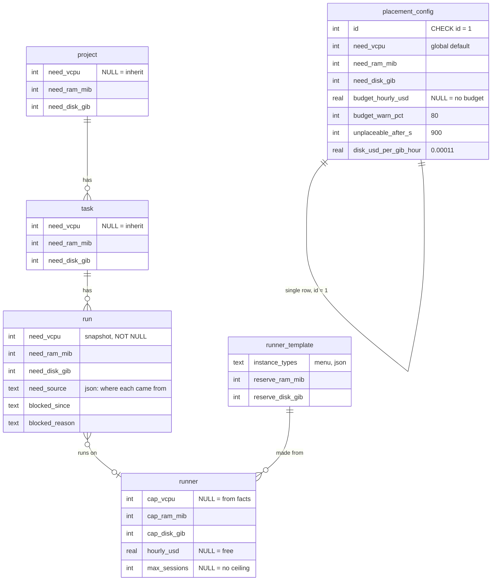
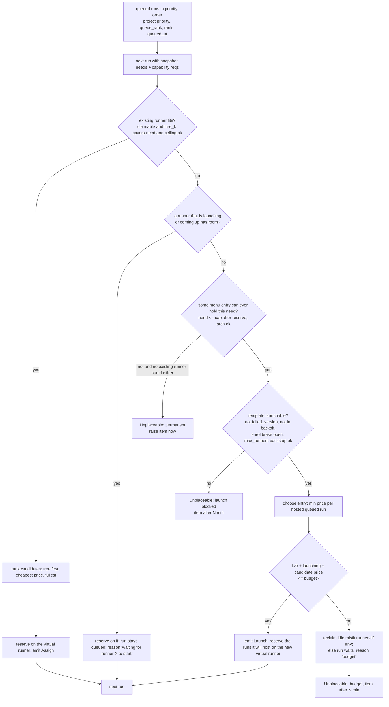

# ADR 0009: Resource-based placement, an hourly cost budget, and the "unplaceable" Inbox item

- Status: **Accepted 2026-11-09 (the owner adopted every recommendation in section 12), not built.** Implementation is tracked by the milestone "Resource-based placement (ADR 0009)" in the wrangl project; stages ship one at a time. Interim: the `wrangl` project's template was switched to `host` on 2026-11-09 (the host runner has Go, mise and an authenticated `claude`), so it uses the idle controller host's four slots; there is no overflow to `go-claude` until stage 1 task 3 lands.
- Task: TMB6BJ
- Supersedes (in part): [ADR 0007 (capabilities vs capacity)](0007-capabilities-and-capacity.md). See section 9 for what survives and what does not. ADR 0007's status line is updated to point here; its body is kept for the verified context it records.
- Builds on: [ADR 0002](0002-remote-runners.md), [ADR 0008 (runners belong to the system)](0008-runners-belong-to-the-system.md); migrations 00020 (`max_sessions`), 00025 (`project_template_limit`, `runner.launched_for_project`), 00027 (remote targets), 00036 (the `tool_error` question kind, the pattern reused here)
- Touches (future work): `controller/scheduler/{assign,scheduler}.go` (plus a new pure `placer` package), `db/queries/{run,runner,question}.sql`, `controller/fleet/{template,fleet}.go`, `controller/costs` (prices), `web/{inbox,views_runners}.go`, `cli/{task,project,template,fleet}.go`, migrations 00037+

Design only; no application code changes. Paths are under `cmd/wrangl/internal/`.

**Why a new ADR instead of editing 0007.** The change is large. 0007's central ideas (session slots as capacity, pools with cost classes, count caps per pool and project, an ordered template fallback as stage 1) are replaced, not tweaked; only its capability-tag half and its host guard survive. Rewriting 0007 in place would erase the record of why those were chosen and what the code looked like when they were. So 0009 supersedes the slot/pool/cap half, 0007 stays as history and keeps the capability-tag half until a later ADR or stage retires it (section 9).

## 1. Context

### 1.1 What the code does today (re-verified for this ADR)

1. **Capacity is a count of sessions, not resources.** A runner is full when `COUNT(run in assigned, preparing, running, needs_input, pushing, cancelling) >= runner_template.max_sessions` (`FreeRunnerSlot` and `ClaimIdleRunner` in `db/queries/run.sql`). Every template has `max_sessions = 4` (migration 00020 default). A session on a 2-vCPU box and one that needs 24 GiB of RAM count the same.
2. **The runner already knows its own size.** `runner.vcpu`, `ram_mib`, `disk_gib`, `arch`, `instance_type` are filled from the facts the daemon reports at enrolment (`fleet.go` checks them against the template minimums with a tolerance). Nothing in placement reads them. The heartbeat also carries `CPUPercent, MemPercent, DiskPercent, Load1` into `runner.last_metrics_json`; nothing reads that either.
3. **Placement is by template id.** `assignOne` passes the run's effective template (`COALESCE(run.template_id, task.template_id, project.default_template_id)`) to `FreeRunnerSlot` and `ClaimIdleRunner`; both filter `n.template_id = ?`, require `n.template_version = t.version`, and pack busy runners first (`ORDER BY (n.state = 'busy') DESC, n.idle_since`). There is no fallback. The adopted host runner (`launched = 0`, template `host`) is therefore used only by projects whose effective template is `host`.
4. **Autoscaling is per template, in counts.** `Scheduler.Tick`: `need = demand - supply` from `TemplateDemand`, `hosts = ceil(need / max_sessions)`, `n = min(hosts, max_runners - live)`, then `PlanLaunches` splits among projects in priority order, each bounded by `EffectiveCap(stored, isDefault, max_runners) - live` (migration 00025: 1 for the project's default template, 0 for every other). Brakes: `failed_version == version`, a per-template backoff (1 to 30 min), and `MaxEnrolFailures = 3` never-enrolled runners in 1 h (`OnLaunchStuck`).
5. **Instance choice is a preference list plus minimums.** `provision/ec2.go`: if the template lists `instance_types`, the first one in the list that meets arch, `min.vcpu` and `min.ram` is used; otherwise the smallest current-generation type meeting them (`sortCandidates`: fewest vCPUs, then least memory). Disk is the template's `min.disk` as the volume size. Price plays no part in the choice.
6. **Prices already exist in the controller.** `controller/costs` reads on-demand Linux rates (`Service.Price(ctx, region, type)`, AWS Pricing API, cached, with an `indicativePrice` fallback table flagged "indicative") and instance specs (`DescribeInstanceTypes`) for the template editor and a spend view. `fleet.CostWarning` already flags EC2 Mac's 24-hour minimum. No scheduling decision uses them.
7. **Waiting is mostly silent.** `Assign` leaves a run queued when `FreeRunnerSlot` returns 0 (it returns `sql.ErrNoRows`, which `tolerated` swallows). Only `resolveAgent`, `mintToken` and secret failures write `run.status_text` through `SetRunStatus`. A run whose template can never be launched (a failed version, an exhausted cap, a type that no longer exists) waits forever with no text and no notification; only the enrol-failure brake raises anything (`OnLaunchStuck`, a log/push, not an Inbox item).
8. **Questions are the Inbox.** `question.kind` is a CHECK-constrained set (`agent, pr_review, approval, plan_review, system, deliverable_review, task_review, tool_error`). `tool_error` (migration 00036) widened the constraint in place with a `writable_schema` replace and a throwaway-table schema bump, is created by `runs.noteToolError` (one open item per run and tool, one `Dismiss` option), is cancelled with the run by `CancelRunQuestions` (`kind IN ('agent','system','tool_error')`), and is rendered by a `case` in `web/inbox.go`.
9. **No global settings table exists.** Verified: no migration creates one.

The wrangl project is pinned to `go-claude` with a per-template limit of 1 and `host=0`, so it always pays for a runner while the host (about 8 vCPU / 31 GiB, 6% CPU, RAM 58% and disk 71% used in the figures the task cites) idles. Those host figures come from the task text and were not re-measured.

### 1.2 What the owner wants

Replace fixed slots per runner with a small standard set of resource needs. Placement reads the run's needs and puts it on a runner where all of them (and the capability tags) are met, launching more runners when none fits. Launching is bounded primarily by a maximum hourly cost, not by counts. A run that cannot start for reasons only the owner can fix raises a new Inbox item instead of waiting silently.

## 2. Vocabulary

- **Need set**: the resources a run reserves while it is active: `vcpu`, `ram`, `disk` (section 4). The owner's word; the data model says `need_*`. Not to be confused with a task's *precursors* (`wrangl task needs add`, the MCP `task_needs_add` tool), which are dependencies between tasks. The CLI flag is `--need` as the owner wrote it (it is on `create`/`edit`, so there is no parser clash); the docs always say "resource need".
- **Capacity**: what a runner can give. Per resource, `cap_k`. Distinct from the need set.
- **Reservation**: the need sets of the runner's active runs. `free_k = cap_k - sum(need_k of active runs)`.
- **Capability**: a non-quantitative fact (arch, tool, agent auth, driver). ADR 0007's tags and requirements keep this meaning.
- **Price**: USD per hour of a live runner. **Budget**: the ceiling on the sum of prices.
- **Template**: a recipe, as today, plus an **instance menu** (types with capacity and price).
- **Unplaceable**: a queued run that no existing runner can host and no allowed launch can fix without the owner's action.

## 3. Options

### 3.1 How to model capacity

**(A) Keep slots, make them per-runner and optional** (ADR 0007's `runner.max_sessions` plus a guard). Cheap, but a slot says nothing about what a session needs; the owner's "big-RAM task" cannot be expressed, and the number of slots must be guessed per box.

**(B) Resource accounting with reservations (chosen).** Each runner has capacity per resource; each active run reserves its need set; fit is a comparison. Deterministic and explainable ("needs 24 GiB, largest free is 11 GiB"), works on the host and on launched runners alike, and gives the autoscaler something to compute (how many runs fit on a new type).

**(C) Measured load only** (place by current heartbeat CPU/RAM/disk). Reality-based, but not deterministic: two runs queued in the same tick both see the same free memory; a run that has just started has not yet consumed it, so a burst overcommits; and nothing can be said about a machine that does not exist yet (the launch decision needs a number before launch). Rejected as the predicate; kept as a brake (section 6.3).

### 3.2 How to guard cost

**(A) Count caps** (`max_runners`, `project_template_limit`), the status quo. They bound instance count, not money: ten `t4g.medium` and ten `m7g.2xlarge` are the same "10". They also couple a project to a template name.

**(B) Hourly budget (chosen).** Sum of the hourly prices of live and launching runners plus the candidate must stay at or under a ceiling. It bounds what the owner actually cares about, treats different shapes fairly, and makes "cheapest that fits" the natural launch rule.

**(C) Monthly budget with burn-rate tracking.** Closer to the invoice, but needs history and forecasting; the existing spend view (`costs`) is the place for that. Out of scope; an hourly ceiling is the simple control.

### 3.3 What to do with work that cannot start

**(A) Wait with a visible reason only** (stage-1 style). Fixes the silence, but a permanent mismatch (needs 64 GiB, biggest type has 32) would wait forever and the owner has to be looking at the Queue.

**(B) Fail the run.** Wrong for temporary causes (budget) and it throws away queue position.

**(C) Keep it queued, show the reason, and raise an Inbox item when it is permanent or has been stuck for N minutes (chosen).** The Inbox is where the owner already looks; the item carries the fixes as options and cleans itself up.

## 4. The need vocabulary

Closed and small on purpose: three resources, all of which a machine genuinely runs out of, all of which the controller can know before launch.

| Name | Unit (accepted input) | Stored as | Global default | Floor | Why a resource |
|---|---|---|---|---|---|
| `vcpu` | whole vCPUs (`1`, `2`) | `INTEGER` | 1 | 1 | Compressible, but a compile or test run really uses it. |
| `ram` | `MiB` stored; `512MiB`, `2GiB` accepted | `INTEGER` MiB | 2 GiB | 512 MiB | Not compressible: out-of-memory kills the agent. |
| `disk` | `GiB` stored; `5GiB`, `500MiB` accepted | `INTEGER` GiB (rounded up) | 5 GiB | 1 GiB | Not compressible: each session has its own git worktree and toolchain caches; disk was already the host's tightest limit (71% used). |

The defaults are the owner's example (1 vCPU, 2 GiB, 5 GiB). Fractional vCPUs are deliberately not supported (a whole number is enough to bin-pack agent sessions, and `t4g` burst accounting does not make fractions meaningful).

**Storage: columns, not JSON.** The set is closed, the fit predicate is evaluated in SQL (`UPDATE ... WHERE` for the atomic claim, and `SUM` over active runs), and typed columns keep that simple and indexable. Adding a resource is a migration, which is the right amount of ceremony for changing the vocabulary. JSON would let it drift and would need `json_extract` in every hot query.

**Deliberately not resources** (each has a better home):

- *Sessions / concurrency count*: a derived, optional ceiling (`runner.max_sessions`), not a thing a task asks for.
- *Architecture, installed toolchains, agent auth, driver role*: **capabilities** (ADR 0007 tags). A task asks `arch=arm64`, not for "an ARM amount".
- *GPU*: a capability tag (`gpu`) until a template with GPUs exists; promote to a fourth resource then, by migration.
- *Network bandwidth, IOPS, local-SSD*: not controllable or measurable per session today.
- *Wall-clock time*: the run timeout is a separate setting.
- *LLM quota / API rate limits*: belong to the agent definition and its secret, not to the machine.
- *Money*: the budget (section 7), never a per-task field.

### 4.1 Where it is stored and edited



| Where | How it is shown and edited |
|---|---|
| Global defaults | `wrangl placement show` / `wrangl placement set --need vcpu=1 --need ram=2GiB --need disk=5GiB --budget 0.50`; Settings page, a "Placement" card. A new single-row table because no settings table exists (verified). |
| Project | `wrangl project edit web --need ram=4GiB` (repeatable; `--need ram=` or `--clear-need ram` clears one field back to inherit); the project settings screen shows each field as `4 GiB (project)` or `2 GiB (default)` with the effective set in the header. |
| Task | `wrangl task create ... --need ram=8GiB`, `wrangl task edit <sqid> --need ram=8GiB`; task page shows the effective set with its source, and an "edit needs" popover. |
| Run | Read-only: the run page shows the snapshot (`1 vCPU · 8 GiB (task) · 5 GiB`) and the runner it holds. |
| Runner / host | `wrangl fleet set host --capacity vcpu=6,ram=12GiB,disk=20GiB`; the runner card shows `used / capacity` for each resource and `3/4 sessions` when a ceiling is set. |

Can a task ask for less than its project default? **Yes, within the floor, but only from owner surfaces (CLI, UI).** Reasons: packing is where the savings are (a doc-only task should not reserve 2 GiB), and the owner's "tasks add, projects set the ceiling" (ADR 0007 Q4) was about *capability requirements*, where weakening a requirement could put a run on a machine that cannot do the job. A smaller reservation cannot do that; the worst case is an overcommitted box, which the measured guard (section 6.3) catches. The agent-facing tools (`task_create`, `task_update` from a running agent) may only raise a need, never lower it, so an agent cannot squeeze its own sibling tasks. There is no per-project *ceiling* on needs: the budget and the "unplaceable" item already stop a runaway request.

## 5. Resolution and snapshot

**Order, per field:** global default < project < task. Each of `vcpu`, `ram`, `disk` resolves independently (a task that sets only `ram` still inherits the project's vcpu and disk). The result is clamped up to the floor (section 4) and, for agent-originated changes, to `max(current, requested)`.

**Snapshot at queue time.** When a run is created (`runs` service, where `template_id` is also fixed) the resolved set is written to `run.need_*`, with `run.need_source` recording which layer won each field (`{"vcpu":"default","ram":"task","disk":"project"}`). From then on placement, reservation and the autoscaler read only `run.need_*`. Editing a project, a task or a default affects runs queued afterwards. It does not affect:

- queued runs (so a waiting run does not change meaning under the scheduler);
- active runs (their reservation is a promise already made).

A retry, revise or resolve creates a new run and therefore a new snapshot. The one explicit way to change a queued run is the "Lower/raise this task's needs" action on the Unplaceable item (section 8), or `wrangl run requeue --resnapshot <id>`; both re-resolve and rewrite the queued run's columns, and say so in the run's event log. Legacy runs present at migration get the snapshot `0/0/0` so they behave as today (section 10).

## 6. Resource accounting and the fit predicate

### 6.1 Capacity

`runner.cap_vcpu / cap_ram_mib / cap_disk_gib` are the capacity placement uses.

- **Launched runner:** set at enrolment from the facts the daemon reports, minus the template's reserve for the OS, the daemon and caches: `cap_ram = ram_mib - reserve_ram_mib` (illustrative default 1024), `cap_disk = disk_gib - reserve_disk_gib` (illustrative default 8), `cap_vcpu = vcpu`. Facts are the truth because an instance type's advertised size and what the box reports can differ; the template's `min` values stay as the sanity check at enrolment, as now.
- **Host:** an explicit owner setting (`wrangl fleet set host --capacity ...`), defaulting to `facts - reserve` where the default reserve for an adopted runner is generous (25% of vCPU and RAM, 30% of disk), because the host also runs the controller, the database and anything else the owner does there. From ADR 0011, each primary Claude session on the host takes a further 700 MiB off the derived RAM default (`placement.HostPrimaryReserveMiB`, counted from the heartbeat's session scan); an explicit `--capacity ram=` is taken as given. Reservation, not measurement, is what the fit predicate uses (3.1 C); the measured guard in 6.3 is the brake.
- NULL columns mean "derive from facts" so adoption of old rows needs no data migration beyond the column add.

### 6.2 The fit predicate

For a run `r` (snapshot needs `n_k`) and a runner `x`, with `k` in `{vcpu, ram, disk}`:

```
active(x)   = runs on x in state assigned | preparing | running | needs_input | pushing | cancelling
free_k(x)   = cap_k(x) - SUM(run.need_k for run in active(x))

claimable(x) = x.state IN (idle, busy) AND NOT cordoned AND NOT drain_requested
               AND upgrade_sha = '' AND template_version = template.version
               AND NOT closed_by_guard

fits(r, x)  = claimable(x)
              AND n_k(r) <= free_k(x)                       for every k
              AND (x.max_sessions IS NULL OR |active(x)| < x.max_sessions)
              AND capabilities(r) subset-of capabilities(x)      -- ADR 0007 tags, once built
```

The "claimable" part is exactly what `ClaimIdleRunner` requires today; the new parts are the resource lines and the nullable session ceiling. The claim stays a single conditional statement: `ClaimRunner(runner_id, run_id)` re-evaluates `free_k` in its `WHERE` (a subquery over active runs including the new one), so a concurrent change loses the race and the next candidate is tried, as `release()` already supports. `Assign` is a single goroutine today, so contention is rare, but the statement must not rely on that.

A runner *coming up* (`launching`, `enrolling`, `provisioning`) counts for planning (virtual capacity = its planned `cap_k`, as `TemplateDemand` counts launching slots today) but cannot be assigned to until it is `idle`. A runner behind its template version counts as zero capacity and the run's reason says so (the stall fix from ADR 0007 1.2 is kept).

### 6.3 `max_sessions`, `needs_input`, and the host

- **`max_sessions` is kept as an optional per-runner safety ceiling, default NULL (no ceiling) for new runners.** Reasons to keep it: it is an operator-meaningful brake independent of anyone mis-sizing needs (a bug that sets every need to the floor would otherwise let one box take 50 sessions), and it is the migration's anchor (section 10). During stages 1 to 4 it is copied from the template at enrolment (4, as today) so nothing changes; stage 5 changes the template default to unset. The template YAML key stays and means "the ceiling for runners from this recipe".
- **`needs_input` keeps its full reservation** (as it holds a slot today). It holds a worktree, a process and an agent context. RAM and disk are not compressible and the process is still resident; only vCPU is compressible. Stage 5 offers an optional policy: after `needs_input_grace` (10 min) the run stops reserving `vcpu` (only), because an agent waiting for a human burns no CPU and resuming one onto a busy box merely time-slices it. RAM and disk stay reserved. Default off; the owner's call (section 12). `blocked` is terminal and already holds nothing (verified in 0007).
- **The host:** capacity is a reservation against an explicit number (6.1). In addition, from stage 5, a **measured guard** (ADR 0007 section 7.2, kept) closes the host to *new* placements, never killing existing sessions, when a heartbeat shows load/memory/disk over thresholds, with hysteresis. Reservation says "what we promised", the guard says "what is actually true"; neither replaces the other. With the figures cited (8 vCPU, 31 GiB, RAM 58%, disk 71%) a sensible declared host capacity is **6 vCPU / 12 GiB / 20 GiB**, the RAM figure being roughly what the box has free after its current 58% use, the disk figure leaving the host under about 85% (disk size is not given in the task; the 20 GiB is an assumption to adjust when `runner show host` reports the real volume).

## 7. Placement

### 7.1 One pure function

The scheduler's DB code gathers snapshots; a new pure package `controller/placer` decides. Both `Assign` (which attaches runs to runners) and `Tick` (which launches) call it, so the plan the autoscaler makes is the plan the assigner will carry out, with no divergence between "supply" and "claim" logic (a root cause of the 0007 stall).

```go
// Inputs are plain values; no DB, no clock beyond the `now` argument.
type Plan struct {
    Assign       []Assignment   // run -> existing claimable runner
    Launch       []LaunchPlan   // template + instance type + the runs it will host
    Unplaceable  []Blocked      // run, reason code, human text, best-fit hint
}
func Place(runs []Run, runners []Runner, menu []MenuEntry, budget Budget, now time.Time) Plan
```

### 7.2 Flow



The pass is **sequential in queue order** and reserves as it goes on virtual copies of the runners, so a later, lower-priority run never takes room an earlier one was entitled to, and one launch is credited with every queued run it can host (7.4).

### 7.3 Choosing among existing runners

For a run that fits more than one runner, in order:

1. **Already running before launching.** Every claimable runner is preferred to any launch; a launch is only planned when no existing or arriving runner fits (the owner's "prefer already-running").
2. **Cheapest.** Lowest `runner.hourly_usd` (host = 0 and so first). Rationale: filling the cheap machine first lets the expensive one go idle and be reaped.
3. **Fullest** (best fit). Smallest leftover after placement, `sum_k (free_k - need_k) / cap_k`, then longest idle. This is today's "busy first" rule generalised, and it keeps whole runners empty so `ReapCandidates` can reap them.

### 7.4 Choosing what to launch, and hosting several runs per launch

Templates declare an **instance menu** (section 7.5). For the runs still unplaced after the existing runners, in queue order, the placer considers each launchable template and menu entry `e` and simulates packing the unplaced runs onto one new runner of that type (first-fit in queue order, honouring `fits` and the ceiling). It scores each entry by

```
score(e) = price(e) / hosted_runs(e)         -- hosted_runs >= 1 or the entry is discarded
```

and picks the lowest score; ties go to the entry that hosts more runs (fewer launches means fewer enrolments to fail), then the lower absolute price, then the template name. Then it removes the hosted runs and repeats until the queue is covered, the budget stops it, or nothing is launchable. That is *not* "smallest type that fits the head run": with three queued 1-vCPU runs and a menu where a 2-vCPU box hosts two, hosting two on one launch beats three single launches, and a 4-vCPU box may beat both. It also never launches for imagined work: only queued runs count, so a speculative large box is not bought for one small run.

A launch is attributed to the project of the first run it was planned for (`launched_for_project` is kept for the attribution display; it is no longer a cap).

### 7.5 The instance menu and where capacity and price come from

Today `instance_types` is a list of preference strings. It stays valid and becomes the menu, with optional overrides:

```yaml
name: go-claude
arch: arm64
min: { vcpu: 1, ram: 2GiB, disk: 30GiB }     # the smallest acceptable box and the volume size
reserve: { ram: 1GiB, disk: 8GiB }           # not available to sessions
instance_types:
  - t4g.medium                               # capacity and price looked up
  - t4g.large
  - { type: c7g.xlarge, price: 0.145 }       # explicit price overrides the lookup
  - m7g.xlarge
  - m7g.2xlarge
max_runners: 6                               # optional backstop; see 8.4
```

- **Capacity** of an entry: `DescribeInstanceTypes` (vCPU, memory) via the existing EC2 client, minus `reserve`; disk is a launch-time choice (below). An entry whose arch differs from the template's, or that does not exist in the region, is dropped with a warning at `template create`.
- **Price** of an entry, in this precedence: the explicit `price:` in the template; the live rate from `costs.Service.Price(region, type)`; the `indicativePrice` fallback (flagged `indicative`); otherwise **unknown, and an entry with an unknown price is not launched** (fail closed, because a budget cannot be enforced against an unknown number). The effective price adds the volume: `disk_gib * disk_usd_per_gib_hour` (an EBS gp3 rate in `placement_config`, about $0.00011/GiB-hour, i.e. $0.08/GiB-month; illustrative).
- **Disk** is sized at launch to `max(min.disk, sum of the hosted runs' disk needs + reserve)`, so a task asking for 200 GiB can be hosted by a fresh runner with a bigger volume rather than being unplaceable, subject to a template `max_disk` (default 500 GiB, a sanity limit).
- **Host:** price 0, capacity as set in 6.1, no menu.
- **No menu** (legacy templates): the entry list is derived exactly as `provision/ec2.go` derives it today (smallest current-generation type meeting `min`), so old templates keep launching.
- **Remote targets (mac etc.):** a target has no resource accounting: its capacity is its session count (the `max_sessions` on the target template, as `ClaimTarget` uses). The *driver* session reserves a need set on the driver runner as for any run. Target price counts in the budget; for EC2 Mac the 24-hour minimum is a held cost, so the placer counts `24 * hourly` against the budget for the first 24 hours (the existing `CostWarning` text is attached to the Inbox item if that is what blocks).

## 8. Cost budget

### 8.1 Scope and source

One **global** ceiling `placement_config.budget_hourly_usd` (NULL = no budget enforced; count caps behave as today, section 10). Not per project: runners are shared, so a project's share of a runner's price has no honest answer (this is ADR 0008's problem again), and a per-project budget would force an allocation rule nobody asked for. A per-project soft *share* can be added later as reporting (see Q3).

### 8.2 What counts

`committed = SUM(runner.hourly_usd)` over every runner not `terminated`: `launching, enrolling, provisioning, idle, busy, cordoned, draining, offline`. Draining and offline runners still bill, so they still count; they leave the sum when the controller records the instance terminated. Remote targets count likewise. Launches planned earlier in the *same* pass count too (the placer's virtual runners), so one tick cannot launch past the ceiling. The host is price 0.

Launch is allowed iff `committed + price(candidate) <= budget`. `runner.hourly_usd` is stamped at launch from the price used in the decision, so a later change in a price table does not change history, and the sum is a column sum in SQL.

### 8.3 Approaching and exceeding

- **Approaching** (`committed >= budget_warn_pct` of budget, default 80): a fleet note ("Hourly spend $0.42 of $0.50") once per crossing with hysteresis (re-arm below 70%), a banner on the Runners page, and the budget shown on `wrangl fleet list`. Nothing is blocked.
- **At the ceiling with queued work:** the run waits; its `status_text` says exactly why (`waiting: hourly budget $0.50 reached ($0.47 in use; c7g.xlarge would add $0.145)`) and `run.blocked_since` is stamped. Before giving up, the placer **reclaims**: any `idle` launched runner with no active runs that cannot host any queued run is reaped now instead of after `idle_timeout`, because it is what is consuming the budget. Runners that can host a queued run are never reaped.
- **Stuck for more than N minutes** (`unplaceable_after_s`, default 900, global): the Unplaceable item (section 9) is raised, kind `budget`. If other runs finish and idle runners are reaped so that the launch fits, the item resolves itself.
- **Count caps:** while a budget is set, `project_template_limit` is not consulted for launching (rows kept for rollback) and `max_runners` remains as an optional per-template backstop (it is the only protection against a mispriced or unpriced template and the natural way to limit Macs). With no budget set, both behave exactly as today.

## 9. The "unplaceable" Inbox item

### 9.1 When it is raised

A queued run is **blocked** when the placer returns it in `Unplaceable`. The reason code decides when the owner hears about it:

| Reason code | Meaning | Raised |
|---|---|---|
| `too_big` (permanent) | The need exceeds every launchable menu entry's capacity (after reserve and `max_disk`) **and** every existing runner's capacity, e.g. `ram=64GiB` against a largest type of 32 GiB. Cannot become true by waiting. | Immediately. |
| `no_capability` (permanent) | No template provides a required capability (arch, tag, agent) and no runner has it; or the pinned template does not exist/was deleted. | Immediately. |
| `price_unknown` | The only entries that could host it have no known price and a budget is set. | After N minutes. |
| `budget` (temporary) | Placeable only by launching, and the launch would exceed the budget (after reclaim). | After N minutes since `blocked_since`. |
| `launch_blocked` (temporary) | Placeable only by launching, but the template's current version failed to apply, is in backoff, the enrol brake tripped, or `max_runners` is full, and nothing else fits. | After N minutes. |
| `capacity` (temporary) | Fits somewhere in principle but the host and every runner are full and no launch is allowed (no template permitted for the project). | After N minutes. |

**Not** unplaceable: a run that fits on an existing busy runner and just waits for another run to finish, or a run waiting for a runner that is launching. That self-resolves and keeps a plain reason on the run. The line is "only the owner can fix it" (permanent immediately, otherwise after N minutes of not being placeable).

### 9.2 Question model

A new question kind `unplaceable`, added exactly as `tool_error` was:

1. **Migration 00037** widens the CHECK in place with the same `writable_schema` replace and the throwaway-table schema bump: `replace(sql, '''tool_error'')', '''tool_error'', ''unplaceable'')')` on `question` (down: `SELECT 1;` like 00030/00036). The migration also adds a partial unique index for dedupe: `CREATE UNIQUE INDEX question_unplaceable_open ON question (run_id) WHERE kind = 'unplaceable' AND state = 'open';`.
2. **`CancelRunQuestions`** (`db/queries/question.sql`) gains `'unplaceable'` in its `kind IN (...)` list, so cancelling or finishing a run drops the item (`runs.go:146` already calls it).
3. **`web/inbox.go`** gets a `case "unplaceable"` with tag `⛔ can't be placed` (class `k-failed`) and the option rendering below; `proto.QuestionView` carries `Kind` already.
4. **Creation** in a new `scheduler.noteUnplaceable` (the analogue of `runs.noteToolError`), `CreateQuestion` with `Kind: "unplaceable"`, `RunID`, a prompt, a markdown detail, and `payload_json` such as `{"reason":"too_big","need":{"vcpu":1,"ram_mib":65536,"disk_gib":5},"best":{"type":"m7g.2xlarge","ram_mib":31744},"budget":{"limit":0.5,"committed":0.47,"needed":0.145}}`.

### 9.3 Text and options

Prompt: `Can't place <TASK>: needs 64 GiB RAM` (one line, reason-specific). Detail (markdown), for example:

> `abc123 Add the vector index` has been waiting 15 minutes. It needs **1 vCPU · 64 GiB RAM · 5 GiB disk** (RAM from the task).
> The largest machine any template can launch has 31 GiB usable (`m7g.2xlarge`), and the host has 12 GiB. This cannot be placed as asked.

Budget variant: `Hourly budget reached: $0.47 of $0.50 in use; the cheapest machine that fits (m7g.2xlarge, $0.326/h) needs $0.80/h in total.`

| Option (`value`) | Shown when | Effect |
|---|---|---|
| **Raise budget to $X/h** (`raise_budget`) | `budget`, `launch_blocked` caused by budget | Sets `budget_hourly_usd` to the minimum that places this run (rounded up to the cent); the next tick launches. An answer; audit-logged. |
| **Edit this task's needs** (`edit_needs`) | always except `no_capability` | A link to the task's needs editor (not an answer; the item stays open). Saving offers "apply to the queued run" which re-snapshots it (section 5); once placeable the item resolves itself. |
| **Use template X** (`use_template:<name>`) | a launchable template/entry would host it but the run is pinned elsewhere or the project's allowed set excludes it | Sets the task's template to X (one answer value per candidate, at most 3). |
| **Keep waiting** (`wait`) | temporary reasons | Answers the item; the run stays queued with its reason; re-raised only if the reason code changes or after 24 h. |
| **Cancel the task's run** (`cancel_run`) | always | Cancels the queued run through the existing run-cancel path. |

### 9.4 Dedupe and auto-resolve

- **Dedupe:** one open item per run (the partial unique index; the creator checks first as `noteToolError` does). If the reason changes while open (for example `budget` becomes `too_big` after a template edit) the existing item's prompt, detail, payload and options are updated in place and the bus notified, not a second item.
- **Auto-resolve:** every `Assign` pass, after planning, cancels open `unplaceable` items whose run is placeable (appears in `Assign` or `Launch`, or has been assigned) or is no longer queued; state `cancelled`, `answer_text = 'resolved: placeable'`. Cancelling the run and `AssignRun` success both call `CancelRunQuestions` too. Resolution emits the same `Bus.Question` event as creation, so a live Inbox updates.
- **Push:** the first raise per run sends one notification through the existing `OnNeedApp`-style hook (hourly de-dup per run), because this is exactly "the owner must act".

## 10. Reconciling with ADR 0007 and migrating from today

| ADR 0007 element | Fate |
|---|---|
| Capability tags and requirements (`template_capability`, `runner_capability`, `requirement`, probes) | **Survives, unchanged**, as the "capabilities" half of `fits`. Still its own stage, now independent of resources (stage 6 here). The implicit `template=<name>` tag survives as the pin that keeps a project on one template until the owner lifts it. |
| Session slots as capacity | **Superseded** by resource reservations; `max_sessions` demoted to an optional per-runner ceiling (6.3). |
| Pools, cost classes (`free/low/standard/premium`), pool rank | **Dropped.** The real hourly price replaces a coarse class, and "host first" falls out of price 0. |
| `max_runners` per template | **Kept as an optional backstop**, no longer the primary guard. |
| `project_template_limit` and `--limit`, `EffectiveCap`, `PlanLaunches` caps | **Superseded** by the budget when one is set; deprecated and removed in the last stage. `PlanLaunches` priority-ordered splitting is replaced by queue-order planning in `Place`; the queue order itself is unchanged. |
| `project_template_order` ordered fallback (0007 stage 1) | **Not built.** Replaced by "any claimable runner that fits"; the allowed set is the project's effective template plus the host until capability tags land (section 11, stage 1). |
| Reason strings (0007 5.1) | **Survive** as the visibility layer, extended with resource and budget wording. |
| Host measured guard (`closed_by_guard`, hysteresis) | **Survives**, as the brake (6.3), stage 5. |
| `needs_input` grace | **Survives in a narrower form** (vCPU only), default off. |
| Version-behind runner supply fix | **Survives**, now inside `Place`. |
| Remote targets: target plus driver | **Survives**; the driver session reserves a need set (7.5). |
| Backoff, enrol-failure brake, `failed_version` | **Survive**; now inputs to `launch_blocked`. |

### 10.1 Equivalent configuration so that stage 1 and 2 change nothing

Today's behaviour is "4 sessions per runner, per-template, per-project count limits". It is reproduced by:

- **Global need set `0 vCPU / 0 MiB / 0 GiB`** (a migration-only value; the floor applies to *new* values the owner enters, not to this seeded set), so `n_k <= free_k` is always true; and
- **`runner.max_sessions = 4`** (copied from the template, as 00020 already makes it) as the ceiling, so `fits` reduces to exactly today's `COUNT(active) < max_sessions`; and
- **no budget** (`NULL`), so `project_template_limit` rows and `max_runners` decide launches as now (`wrangl` stays pinned to `go-claude` with limit 1); and
- **legacy runs snapshot `0/0/0`**, and existing templates get no menu, so the instance choice is today's.

When the owner is ready to move to real needs the equivalent *resource* setting for a `go-claude`-sized runner is the runner's capacity divided by four: for a 4 vCPU / 8 GiB box with the 1 GiB reserve and 8 GiB disk reserve (4 / 7 GiB / 22 GiB usable), a need set of `1 vCPU / 1.75 GiB / 5.5 GiB` also yields exactly four sessions, which shows why 1 / 2 GiB / 5 GiB (the owner's example) gives **3** on that box (RAM-bound: 7 / 2 = 3). Hence the staged flip in 11: turn resources on, compare the queue, then adjust defaults.

## 11. Staging

Each stage ships alone and is safe if later stages never land. Stage 1 is the owner's first: visibility, the host as a placement target, and the new item.

### Stage 1: visibility, host as a target, the Unplaceable item (no resources yet)

- **Scope:** (a) a waiting reason on every queued run that cannot be assigned, written with `SetRunStatus` only when the text changes (the reasons of 0007 5.1 plus `blocked_since`), shown on the Queue row, run page and `wrangl run show`; (b) the **host as a placement candidate**: a project may be allowed to use runners of the `host` template in addition to its effective template (`project_allowed_template(project_id, template_id)`, empty = today). `assignOne` tries the effective template's runners, then allowed ones, preferring the free host; the autoscaler launches only if neither has a free slot (slot-based still; supply fix included); (c) the **`unplaceable` question kind** (migration 00037, `CancelRunQuestions`, inbox rendering) raised for the reasons that need no resource model: `no_capability` (the pinned template is missing or deleted; immediately) and `launch_blocked` / `capacity` (a failed template version, the enrol brake, or all count caps full with nothing live and nothing free; after N minutes). Options at this stage: `wait`, `cancel_run`, `use_template`; `edit_needs` and `raise_budget` appear in stages 2 to 4.
- **Migration:** 00037 (question kind, partial unique index, `run.blocked_since`, `run.blocked_reason`, `project_allowed_template`).
- **Verify:** scenarios 1, 2, 4, 5, 10, 11 (section 13); golden tests of the reason strings; the new item appears, dedupes, resolves.
- **Rollback:** revert code; the table and columns are inert; the CHECK widening is harmless.
- **Unlocks:** the `wrangl` project can opt in to the idle host immediately, and nothing waits silently any more.

### Stage 2: resource needs and reservation accounting

- **Scope:** `placement_config`, `project.need_*`, `task.need_*`, `run.need_*` with the queue-time snapshot; runner `cap_*` and `max_sessions` columns; the pure `placer.Fits` and the `ClaimRunner` conditional claim; runner card and `fleet list` show used/capacity; CLI/UI for needs; `wrangl fleet set host --capacity`. Defaults seeded `0/0/0` so behaviour is unchanged (10.1). Then the owner sets real defaults and per-project overrides.
- **Migration:** 00038 additive columns; backfill `run.need_* = 0`, `runner.cap_* = NULL`.
- **Verify:** scenarios 3, 6, 7 and a property test that with `0/0/0` and `max_sessions = 4` `Fits` equals the old `ClaimIdleRunner` over a table of fixtures; big-RAM task lands on a big runner or the host, never on one without room.
- **Rollback:** set the global set back to `0/0/0`.
- **Unlocks:** the host is used for what it can carry; a big task is no longer treated like a small one.

### Stage 3: need-based launching from an instance menu

- **Scope:** `placer.Place` drives `Tick` (virtual packing of queued runs into existing and arriving runners; launch plan by `price / hosted_runs`); template menu parsing with capacity from `DescribeInstanceTypes` and prices from `costs`; volume sized at launch; `too_big` becomes detectable and raises the item immediately; `use_template`, `edit_needs` options enabled. Count caps still apply (no budget yet).
- **Migration:** 00039 `runner.hourly_usd`, `runner_template.reserve_*`, `max_disk_gib`.
- **Verify:** scenarios 8, 9, 12, 13; replay test: feed recorded demand through old `Tick` and new `Place` with `0/0/0` and compare launches.
- **Rollback:** feature flag `placement.engine = legacy` keeps the old `Tick` for one release.
- **Unlocks:** cheaper launches, several runs per launch, sizing to the task.

### Stage 4: the hourly cost budget

- **Scope:** `budget_hourly_usd`, the `committed` sum, the budget gate in `Place`, idle-misfit reclaim, the 80% note and banner, `budget` and `price_unknown` Unplaceable reasons, `raise_budget` option, `wrangl placement set --budget`. With a budget set, per-project limits stop being consulted.
- **Migration:** none beyond config columns already in 00038 (budget NULL).
- **Verify:** scenarios 14 to 17 (budget at the line, over it, same-tick launches, reclaim).
- **Rollback:** set the budget to NULL; caps return.
- **Unlocks:** the cost guard the owner asked for.

### Stage 5: guard, `needs_input` policy, cleanup

- **Scope:** `EvaluateGuard` on heartbeat and `runner.closed_by_guard` (0007 7.2); optional `needs_input` vCPU release; remove `project_template_limit`, `--limit`, `EffectiveCap`, `PlanLaunches`, the legacy engine and the default `max_sessions` copy.
- **Migration:** 00040 drops `project_template_limit` (down recreates it from `max_runners`).
- **Verify:** scenarios 18, 19; soak on the host watching load and disk.
- **Rollback:** guard thresholds NULL and policy off; the dropped table is the one irreversible step.

### Stage 6 (independent): capability tags and requirements

ADR 0007 stages 2 (tags, probes, requirements, `agent:` requirement). Slots in anywhere after stage 1; it adds the capability line to `fits`.

## 12. Decisions (the owner's questions and the answers adopted)

Each recommendation below is the decision; the italic text is what was recommended and is now binding. Implementers do not need to ask again.

1. **Task lowering its needs?** *Recommend yes from owner surfaces (floored), raise-only for agent tools* (section 4.1). Alternative: only raise, simpler but wastes capacity.
2. **Default global need set** 1 vCPU / 2 GiB / 5 GiB gives 3 sessions on a 4 vCPU / 8 GiB box (RAM-bound), fewer than today's 4. *Recommend starting with 1 / 1.5 GiB / 5 GiB if you want to keep four, or accept three and lean on the budget.*
3. **Per-project budget?** *Recommend no; global only, with a per-project spend report built on `launched_for_project`.*
4. **N minutes** before a temporary item is raised. *Recommend 15; permanent reasons immediately.*
5. **Host capacity** 6 vCPU / 12 GiB / 20 GiB. *Recommend those, then watch `runner show host`; disk first.*
6. **Keep `max_sessions` as a ceiling?** *Recommend keep, default NULL after stage 5.*
7. **`needs_input` releases vCPU after 10 minutes?** *Recommend ship disabled; enable on the host first.*
8. **Unknown prices:** fail closed (recommended) or launch and warn? *Recommend fail closed with the explicit `price:` override as the escape.*
9. **Flag name:** `--need` as written, or `--request`, to avoid the word clash with `task needs` (precursors). *Recommend keep `--need`; docs say "resource need".*
10. **Should the Unplaceable item ever act on its own** (auto-raise the budget by a configured step)? *Recommend no; the owner clicks.*
11. **Mac targets and the 24-hour minimum** counted as 24 hours of committed spend. *Recommend yes; it is the real cost.*

## 13. Scenarios the test suite must cover

Numbers use the worked example in section 14. Prices are illustrative.

| # | Scenario | Expected |
|---|---|---|
| 1 | Host idle, project allowed host (stage 1) | Run goes to the host; no launch. |
| 2 | Host slots full, project allowed host and `go-claude` | Spills to `go-claude`; launches only after the host is full. |
| 3 | Resource fit: host free `4 vCPU / 8 GiB / 12 GiB`, run needs `1 / 2 / 5` | Placed; free becomes `3 / 6 / 7`. |
| 4 | Runner behind template version, busy | Zero supply; reason says so; no stall. |
| 5 | `failed_version` stuck > N min with queued work | Reason on run, then Unplaceable `launch_blocked`; resolves after template fix. |
| 6 | Equivalence: `0/0/0`, `max_sessions = 4` | `Fits` equals `ClaimIdleRunner` on all fixtures. |
| 7 | Snapshot: edit the project need after a run is queued | Queued run keeps its need; a new run gets the new one. |
| 8 | **Big-RAM task** `ram=24GiB` | Not on the host (12 GiB); launches `m7g.2xlarge`; cheaper small types are not chosen; other small queued runs may share it. |
| 9 | **Cheap-first launch**, 3 queued default runs, host full | Chooses `t4g.large` (hosts 2, $0.0336/run) then `t4g.medium` for the third; never `m7g.xlarge`. |
| 10 | Unplaceable item dedupe | Second failing tick updates the one item; a reason change rewrites in place. |
| 11 | Auto-resolve | Item cancelled when the run is assigned or cancelled; `CancelRunQuestions` covers `unplaceable`. |
| 12 | **Unfulfillable need** `ram=64GiB` | Immediate `too_big` item naming the largest option; options exclude `raise_budget`; `edit_needs` and `cancel_run` present. |
| 13 | Same-tick multiple launches | Virtual runners are reserved; the third run does not trigger a launch if the second launch has room. |
| 14 | **Budget hit**: budget $0.30, committed $0.282 (4 x `t4g.large` at $0.0705), run needs a fifth | Launch refused ($0.3525 > $0.30); run waits with the budget reason; Unplaceable `budget` after N min with `raise_budget` to $0.36. |
| 15 | Budget approached | 80% note once; no block. |
| 16 | Reclaim | Idle misfit runner reaped immediately when it is the reason the budget blocks a queued run; a fitting idle runner is not reaped. |
| 17 | Draining/offline runners | Still counted; leave the sum on termination. |
| 18 | Host guard (stage 5) | Existing sessions untouched; new run not placed on host; reopens after hysteresis. |
| 19 | `needs_input` vCPU release (stage 5) | vCPU freed after the grace, RAM and disk still reserved. |
| 20 | Target plus driver | Both claimed or neither; the driver session reserves its need set. |
| 21 | Unknown price | Entry not launched with a budget set; reason `price_unknown`. |

## 14. Worked example (illustrative prices; not a quote)

Host: 8 vCPU / 31 GiB, declared capacity **6 vCPU / 12 GiB / 20 GiB**, price $0. Global need set `1 vCPU / 2 GiB / 5 GiB`. Template `go-claude` (arm64), reserve `1 GiB` RAM / `8 GiB` disk, volume `30 GiB`. Menu (vCPU/RAM from the instance type; usable = RAM minus reserve; prices marked *illustrative*, based on the controller's `indicativePrice` table where present, plus volume ~$0.0033/h):

| Type | vCPU | RAM | Usable RAM | Usable disk | Price/h (illustrative) | Default-need runs it hosts |
|---|---|---|---|---|---|---|
| `t4g.medium` | 2 | 4 GiB | 3 GiB | 22 GiB | 0.0336 + 0.0033 | 1 (RAM-bound) |
| `t4g.large` | 2 | 8 GiB | 7 GiB | 22 GiB | 0.0672 + 0.0033 | 2 (vCPU-bound) |
| `c7g.xlarge` | 4 | 8 GiB | 7 GiB | 22 GiB | 0.1450 + 0.0033 | 3 (RAM-bound) |
| `m7g.xlarge` | 4 | 16 GiB | 15 GiB | 22 GiB | 0.1632 + 0.0033 | 4 (vCPU-bound) |
| `m7g.2xlarge` | 8 | 32 GiB | 31 GiB | 22 GiB | 0.3264 + 0.0033 | 8 by vCPU, 4 by disk -> 4 |

(Disk: a 30 GiB volume leaves 22 GiB, so 4 default runs; a bigger volume is chosen at launch when needed, section 7.5.)

**A. Nine queued default runs, nothing running.** The host takes four (disk: 20 / 5 = 4; vCPU 6, RAM 12 / 2 = 6). Five remain. Candidates per launch: `t4g.large` hosts 2, scoring 0.0705/2 = 0.0353 per run; `m7g.xlarge` hosts 4 (disk-bound with 22 GiB, unless the volume is raised), scoring 0.1665/4 = 0.0416; `t4g.medium` scores 0.0369. The cheapest score is `t4g.large`: launch it for two runs, repeat for two more, then `t4g.medium` for the last. Total committed 0.0705 + 0.0705 + 0.0369 = **$0.178/h**, plus the host at $0. Under a $0.50 budget this launches immediately.

**B. Big-RAM task** (`ram=24GiB`, 1 vCPU, 5 GiB). The host has 12 GiB; every type up to `m7g.xlarge` has at most 15 GiB usable. Only `m7g.2xlarge` (31 GiB) fits: $0.3297/h. With $0.178 already committed, $0.178 + $0.3297 = $0.508 > $0.50, so the launch is refused; the run waits with `waiting: hourly budget $0.50 reached ...`. After 15 minutes the item says the cheapest machine that fits needs **$0.51/h**, and offers *Raise budget to $0.51/h*. If idle `t4g.large` runners exist with no sessions they are reclaimed first, which frees $0.0705 each and may make the launch fit without raising anything.

**C. Unfulfillable.** `ram=64GiB`: larger than every usable RAM including `m7g.2xlarge`'s 31 GiB and the host's 12 GiB, so `too_big` fires immediately; `raise_budget` is not offered because money cannot fix it; the options are edit needs, pick another template with a larger menu, or cancel.

**D. Today's behaviour (10.1).** `0/0/0`, `max_sessions = 4`, no budget, `wrangl` pinned to `go-claude` limit 1: fit reduces to `COUNT(active) < 4`, exactly as the SQL does now.

## 15. Task breakdown (for the wrangl project)

Precursors are listed by title.

**Stage 1**
1. *Waiting reasons for queued runs* — `assignOne`/`Assign` write a reason with counts when no runner/slot, only on change; `run.blocked_since`; strings tested. No precursors.
2. *Supply ignores version-behind runners* — `TemplateDemand` fix and test. Precursors: 1.
3. *`project_allowed_template` and host as a candidate* — table, queries, `assignOne` tries allowed templates, autoscaler respects it, CLI `--allow-template`. Precursors: 1, 2.
4. *`unplaceable` question kind* — migration 00037 (CHECK widening, partial unique index), `CancelRunQuestions`, `noteUnplaceable`, inbox rendering, auto-resolve in `Assign`. Precursors: 1.
5. *Raise `no_capability` / `launch_blocked` items after N minutes* — the stage-1 reasons only. Precursors: 4.

**Stage 2**
6. *Placement config and need columns* — migration 00038, `wrangl placement`, project/task/run columns, CLI/UI editing, floor and clamp rules, agent raise-only. Precursors: none.
7. *Queue-time snapshot* — resolve global < project < task into `run.need_*` and `need_source`; legacy `0/0/0`; test snapshot semantics. Precursors: 6.
8. *Runner capacity and ceiling* — `cap_*`, `max_sessions` on `runner`, set at enrol from facts minus reserve, `fleet set --capacity`, runner card used/capacity. Precursors: 6.
9. *`placer.Fits` and `ClaimRunner`* — pure fit predicate, conditional claim query, ranking (free, cheapest, fullest), equivalence property test. Precursors: 7, 8.

**Stage 3**
10. *Instance menu parsing and capacity/price lookup* — YAML objects or strings, `DescribeInstanceTypes`, `costs.Price`, unknown-price handling, volume sizing. Precursors: 6.
11. *`placer.Place` and the new `Tick`* — virtual packing, score `price / hosted_runs`, same-tick reservation, flag for the legacy engine, replay test. Precursors: 9, 10.
12. *`too_big` and option enablement* — immediate permanent item, `edit_needs`, `use_template`. Precursors: 4, 11.

**Stage 4**
13. *Committed-cost accounting* — `runner.hourly_usd`, sum, approach note and banner. Precursors: 10.
14. *Budget gate and reclaim* — in `Place`, idle-misfit reaping, reasons. Precursors: 11, 13.
15. *Budget Unplaceable reasons and `raise_budget`* — `budget`, `price_unknown`, push once. Precursors: 12, 14.

**Stage 5**
16. *Host measured guard* — `EvaluateGuard`, `closed_by_guard`, UI state. Precursors: 8.
17. *`needs_input` vCPU release policy* — default off. Precursors: 9.
18. *Remove count caps and the legacy engine* — drop `project_template_limit`, `--limit`, `PlanLaunches`, `EffectiveCap`; docs update. Precursors: 14, 15.

**Stage 6 (independent)**
19. *Capability tags and requirements* — ADR 0007 tasks 9 to 13 unchanged; adds the capability line to `fits`. Precursors: 9.

## 16. What was verified and what was inferred

- **Verified by reading the code:** everything in 1.1, including `FreeRunnerSlot`/`ClaimIdleRunner`/`TemplateDemand` conditions and the six active run states, `EffectiveCap` defaults, `Tick` and `PlanLaunches`, the `provision/ec2.go` instance selection rules, `runner.vcpu/ram_mib/disk_gib` columns and the enrolment check, `costs.Price` and `indicativePrice`, the `tool_error` migration, `noteToolError`, `CancelRunQuestions` and the inbox `case`, and the absence of a settings table.
- **Inferred, not tested:** that `provision.Launch` can size the volume per launch (today it passes `DiskGiB = MinDiskGib`, so a per-launch value is a small change but not shown); that `DescribeInstanceTypes` memory matches what the daemon reports to within the tolerance (the existing enrolment check suggests it does); partial unique index support in the SQLite build in use (standard SQLite; the migration test will show).
- **Taken from the task, not re-measured:** the host figures (8 vCPU, about 31 GiB, 6% CPU, RAM 58%, disk 71%). The 20 GiB disk capacity is an assumption.
- **Illustrative:** every price except those in `indicativePrice`; the EBS rate; the reserves; the thresholds and N.
