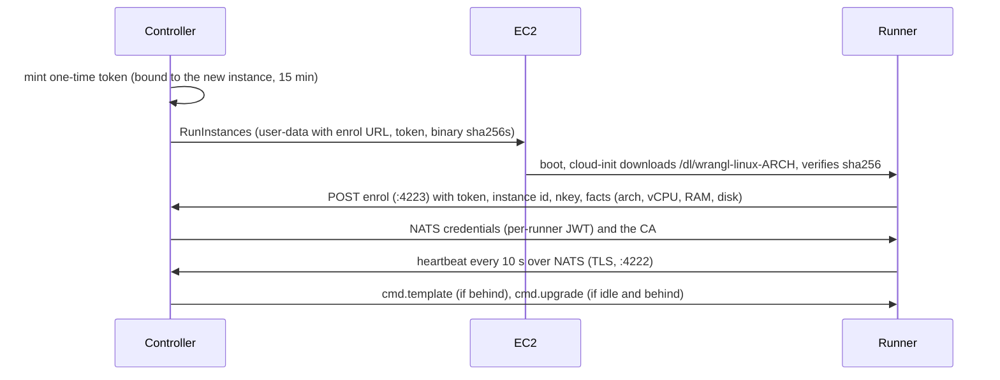

# Runners

A runner is a machine that runs coding agents for wrangl. This guide explains the two roles of the
binary, runner templates, how runners join and stay current, how sessions and git worktrees work,
the controls (cordon, drain, terminate), remote targets, and the screens and commands. Related:
[projects](projects.md), [tasks](tasks.md), and scheduling (in this directory as it is written).

## 1. Concepts

**One binary, two roles.** `wrangl` is a single Go executable. `wrangl controller serve` is the
**controller**: database, embedded NATS, scheduler, HTTP API and web app. `wrangl runner run` is the
**runner daemon**. The same binary is also the CLI, the TUI and the MCP bridge. The controller never
runs agents (except the lightweight "Ask?" and project-chat agents); runners do.

A **runner** is one machine with one daemon. The daemon runs as root because it holds the NATS
credentials, installs the toolchain and pushes to GitHub. The agent itself runs as the unprivileged
`agent` user, which cannot read the daemon's credentials or the GitHub token
(`runner/bootstrap.go`).

A **template** says what a runner is. A **session** is one run's slot on a runner. A runner can host
several sessions at once. Nothing in a runner is tied to a project: placement is by template, and
projects only cap how many runners their demand may *launch* ([projects guide, section 4](projects.md#4-runner-limits-and-the-effective-cap)).

There are two kinds of runner, told apart by the `launched` flag:

| | Launched | Adopted |
|---|---|---|
| Made by | the controller, on a new EC2 instance, from a template | you, on an existing machine, with `fleet enroll-token` + `runner bootstrap` |
| Reaped when idle | yes, after the template's `idle_timeout` | never |
| `fleet terminate` / `drain` | works (terminates the instance) | terminate is refused ("stop the box yourself"); drain only stops new work |
| Powers itself off if orphaned | yes, after 2 hours without its controller (the instance then terminates) | no (the host runner has no poweroff command) |

### The host runner: what it is and is not

The **host runner** is the controller machine enrolled as a permanent adopted runner
(`wrangl runner bootstrap --host`, INSTALL.md section 10.4; template example `templates/host.yaml`).

It **is**: a normal runner for scheduling (it takes sessions of its template), pinned first and
tagged "host" in the Runners view, and the way to get a web terminal on the controller machine. It
runs as a `systemd --user` unit under *your* account, with state in `~/.local/state/wrangl-host-runner`
and config in `~/.config/wrangl-host-runner`, and the agent runs as you.

It **is not**: launched, reaped, or powered off by wrangl (it has no poweroff command and ignores
the orphan timer). It does self-upgrade its binary like any runner, when idle. It does **not apply its template**:
the daemon records the template version as applied and leaves your mise config and machine alone
(`runner/apply.go`, "the machine is managed by hand"), so you must install whatever the agent needs
yourself. It is not isolated: there is no disposable box between the agent and your account. It cannot
be terminated from wrangl.

## 2. Runner templates

A template is YAML (`wrangl template create -f file.yaml`; examples in `docs/wrangl/templates/`).
Fields (`controller/fleet/template.go`; unknown keys are rejected):

| Field | Meaning |
|---|---|
| `name` | Lowercase letters, digits, `-`, max 40. Cannot be renamed. |
| `arch` | `arm64` (default) or `x86_64`. |
| `min` | `vcpu`, `ram`, `disk` (e.g. `8GiB`, `40GiB`). Used to pick an instance type, and checked against what the machine reports at enrolment (10% tolerance on RAM and disk). |
| `instance_types` | Optional list; empty means "the cheapest type that fits `min`". Wrangl does not look at KVM or GPU, so list types when it matters (see android.md). |
| `ami` | Default: the latest Amazon Linux 2023 for the arch (a public SSM parameter). |
| `max_runners` | Account-wide ceiling of instances of this template (default 1). Caps every project's launches. |
| `max_sessions` | Concurrent agent sessions per runner (default 4, at least 1). |
| `idle_timeout` | How long a launched runner may be idle (or offline) before it is terminated; default `30m`, at least `1m`. |
| `mise_toml` | Installed for the `agent` user with [mise](https://mise.jdx.dev): the languages and the agent CLI itself. |
| `setup_script` | Shell run as root when it changes (system packages). |
| `agent:` / `agents: [..]` | The agent: an inline spec, or names of agent definitions allowed on this template (next section). |
| `mode`, `connection` | `local` (default) or `remote`; section 8. |

**Versions.** Each template has a version, 1 at creation and +1 on every `wrangl template edit`
(this also clears a recorded apply failure). `template edit NAME -f file.yaml` replaces the whole
definition, or opens `$EDITOR` on it if no file is given. `template show`, `list` and `delete` (only
if nothing references it) complete the set.

**How a runner applies a new version** (`controller/fleet/templates_apply.go`, `runner/apply.go`):

1. Every heartbeat carries the template version the runner last applied. If it is behind and not
   already applying, the controller sends the template (mise config and setup script) to the runner.
2. This only happens from the **idle** or **enrolling** states. A busy runner finishes its work first.
3. The runner installs mise if missing, runs the setup script as root, then `mise install` for the
   agent user. While applying it is `provisioning`. A timeout of 30 minutes bounds one apply.
4. A runner is only given new work when its applied version equals the template's current version, so
   after an edit, work for that template waits until a runner has caught up (new runners start on the
   latest).
5. If the apply fails, the runner is **cordoned**, the version is marked failed (so it is not retried
   in a loop), and the error and the output tail are shown by `fleet show` and on the runner page.
   Fix the template and edit it again: that bumps the version and clears the failure.

Changing only an agent definition does **not** bump the template version; see below.

### Agent definitions vs templates (ADR 0001)

[ADR 0001](../adr/0001-agent-definitions-vs-templates.md) (accepted, built) splits two things that used to
be one. The **template** says what machine to build and which agents may run on it. The **agent
definition** says how to start and configure an agent: `start` and `resume` commands, `secrets`
(environment variable to controller secret), `secret_files`, `files` written into the worktree (MCP
config, hook config), `expect` rules, `completion` (`tool` or `exit`), `turn_timeout`, and an `auth`
note (`proto/work.go`, `AgentSpec`). Creating a template with an inline `agent:` block creates (or
reuses) a definition and allows it on the template.

```sh
wrangl agent list | show NAME | create NAME -f spec.yaml | edit NAME -f spec.yaml | delete NAME
wrangl agent allow NAME --template T | disallow NAME --template T
wrangl agent auth NAME            # collect the credential: claude setup-token | wrangl agent auth claude
```

Which agent runs: the `task queue --agent` override, else the project's default agent if the template
allows it, else the template's only allowed agent. Editing an agent takes effect for runs assigned
afterwards and needs no template re-apply, because the binary is installed by the template's
`mise_toml`. Secrets belong to the agent; a run on a runner lacking one waits with "agent X needs
secret ...".

## 3. Enrolment and the heartbeat



- The enrol call checks: the token is unknown, used or expired (30 minutes for adopted-runner tokens,
  15 for launched ones); the machine's architecture matches the template; it meets the template's
  minimums; for a launched runner, the request comes from that instance's private IP (so the runner
  must reach the controller inside the VPC, with no NAT in between).
- The runner's NATS permissions are limited to its own subjects, and its own runs.
- A launched runner that has not enrolled within 15 minutes is terminated by the reaper.
- Heartbeats arrive every 10 seconds (`proto.HeartbeatInterval`) with CPU, memory and disk, the
  template version, whether it is applying or upgrading, the number of sessions, and the binary's
  sha256. After 60 seconds of silence (`proto.OfflineAfter`) the runner is marked **offline** (and a
  push notification goes out). A runner offline for longer than the template's idle timeout is
  reaped (if launched). Runs on a runner that has been offline for 10 minutes fail as "runner lost"
  (`runs.LostAfter`); the controller queues one retry, and on a second loss asks you.
- A runner that cannot reach its controller for 2 hours powers itself off (and a launched instance
  terminates on shutdown). Not for the host runner.
- Adopting: `wrangl fleet enroll-token --template T [--ttl 30m]` prints a token; on the machine run
  `wrangl runner bootstrap --controller http://<ip>:4223 --token wre_...` (as root; add `--host` for
  the controller host). The Runners page can do the same for other instances in the account
  ("Other instances ... adopt").

**Runner states:** `launching`, `enrolling`, `provisioning` (applying a template), `idle`, `busy`
(at least one session), `offline`, `terminated`. **Cordoned** and **draining** are flags shown beside
the state, not states of their own.

## 4. Sessions and worktrees

A runner holds up to `max_sessions` runs at once (states assigned, preparing, running, needs input,
pushing, cancelling). The scheduler prefers busy runners that still have room (fewer instances, lower
cost) and then the longest-idle one. A runner is idle only at zero sessions.

Each run gets its own git **worktree** (`runner/worktree.go`):

- One **bare mirror per repo** is kept at `<agent home>/work/.repos/<hash>.git`, keyed by clone URL.
  Sessions of the same repo share one object store and one fetch, under a per-mirror lock.
- Each run works in `<agent home>/work/<run id>`, a worktree of that mirror on the run branch
  `wrangl/<sqid>-<attempt>`, so concurrent runs never touch each other's files, index or branch.
  Each worktree has its own commit identity.
- **Review runs** check the branch out *detached*, so they neither collide with nor disturb the run that
  made it.
- When a run's work is safely pushed, its worktree and branch are removed. **Failed and blocked runs
  keep theirs** so you can look at the diff (`wrangl run diff|files|cat` read it live from the runner).
- A branch can be checked out in one worktree only. When a later run on the same branch needs it (a
  review, revise or Smart Merge after a blocked run), the **stale worktree is taken over**: its HEAD
  is saved under `refs/wrangl/stale/<run id>` first so nothing committed is lost, then it is removed.
  If that earlier run is still live on this runner the new one fails with "branch ... is in use".
- A retried run starts from a clean worktree.

## 5. The agent socket and relayed tools

Agents do not talk to the controller. On each runner the daemon listens on a unix socket that only
the `agent` user may use (`runner/agentsock.go`), and the agent reaches it through hidden CLI helpers:

- `wrangl runner mcp`: a stdio MCP server that exposes the work-stack tools to the agent and relays
  each call through the daemon to the controller. The tools depend on the kind of run
  (`stacktools.For(kind)`): task tools (list, get, create, update, move, complete, needs), `ask_question`,
  `report_status`, `submit_deliverable`, GitHub issue tools, `propose_split` in plan runs,
  `submit_review` in review runs, and `target_exec` / `target_put` on remote runs.
- `wrangl runner hook EVENT`: reads an agent hook's JSON on stdin and posts it to the daemon
  (`POST /hook`); this is how the controller learns that a tool ran, that the agent needs attention, or
  that its turn ended. With `--continue-format` an interactive agent is handed its next task.

Because every call goes through the daemon, the agent never holds the NATS credentials or the GitHub
token; issue tools run on the controller with their own token. See [agents.md](../agents.md) for how each
agent's hooks and MCP config are written.

## 6. Binary self-upgrade

Every heartbeat includes the sha256 of the runner's own `wrangl` binary. The controller compares it with
the binary it serves for that architecture: `<data dir>/bin/wrangl-linux-aarch64` and
`wrangl-linux-x86_64` (the same files that are installed at `/var/lib/wrangl/bin/`; see INSTALL.md
Upgrades).

1. A mismatching runner is marked. A marked runner gets **no new work**, and shows "(upgrading)".
2. When it is **idle** (no sessions, not applying), the controller sends it the expected hash.
3. The runner downloads `/dl/wrangl-linux-<arch>` from the same URL it enrolled with, checks the
   hash, atomically replaces its binary and re-executes under systemd.
4. The next heartbeat with the new hash clears the mark. On failure the old binary stays and the
   controller retries after 2 minutes.

So a deploy is: build, install the controller binary and both runner binaries, restart the
controller; runners follow as they go idle. A development build reports its hash like any other. A
runner that sends no hash has self-upgrade off.

## 7. Cordon, drain, terminate

| Action | CLI | What it does to running work |
|---|---|---|
| **Cordon** | `fleet cordon NAME` / `uncordon` | Stops new assignments. Sessions already on the runner continue. The idle reaper still applies. |
| **Drain** | `fleet drain NAME` | Cordons, and terminates the instance once it has nothing left (idle, offline, enrolling or provisioning). Running work finishes first. Launched runners only; uncordoning cancels the drain. |
| **Terminate** | `fleet terminate NAME` | Terminates the instance **now**. Runs on it are not stopped gracefully: once the runner is gone they fail as "runner lost" (after the 10-minute grace for lost runners) and a work run is retried once. Refused for adopted runners. |
| `fleet teardown` | `fleet teardown [--region --profile --controller-id --all-controllers -y]` | Talks to AWS directly, not the controller: terminates every instance tagged `wrangl:managed=true` (for this controller unless `--all-controllers`). Works when the controller is gone. |

A failed template apply cordons the runner automatically. A `cordoned` runner that is idle is still
reaped after its idle timeout.

## 8. Remote targets (ADR 0002)

[ADR 0002](../adr/0002-remote-runners.md) (accepted, built, experimental) lets an agent drive a machine that
runs no wrangl: an EC2 Mac or an Android emulator host. A template with `mode: remote` and a
`connection:` block (`driver_template`, `protocol` ssh or adb, `user`, `via` ssm or direct, `secret`)
describes the **target**. The agent runs on a **driver** session of an ordinary runner and uses the
`target_exec` and `target_put` tools. A run takes a target session and a driver session together.
The controller launches targets when queued runs need one (within the project's cap on the remote
template, default 0), probes them, marks them offline after three failed probes, reaps them after
`idle_timeout`, and fails the runs on a target that is gone or unreachable for two minutes as
"target lost". `wrangl target list [--all]` and `wrangl target terminate NAME` manage them. There is no
Runners-page card for targets yet. Details, costs and the Android recipe are in INSTALL.md 8.2 and
[android.md](../android.md).

## 9. Screens

**Runners** (`/runners`):
- A spend card: running-now hourly cost across all regions, month to date, and a projection. It needs
  the optional Cost Explorer permissions in aws-iam.md; otherwise it says why it is empty.
- A **Templates** card: each template with its version (a warning if the last apply failed), queued
  demand, live/`max_runners`, and a **Launch** button.
- One card per runner: name (tagged "host" for adopted ones), state, cordoned flag, instance type,
  size, CPU/memory/disk with a sparkline, and the run it is on or how long it has been idle.
- **Other instances in this account** (every region), with their hourly cost; a running one can be
  adopted. A "most expensive other resources" list when Cost Explorer has resource-level data.

**Runner page** (`/runner/NAME`): instance, size, IP, the wrangl binary hash (and the one it is
upgrading to), last heartbeat, load, idle time and last error; buttons for **Terminal**, cordon /
uncordon, drain and terminate (it asks first); a "Working on" card with the run and its task
progress; the template apply log; recent runs.

**Terminal** (`/runner/NAME/term`): one tab per agent session, plus "+ Shell" (fish if installed,
else bash; the first shell installs a few CLI tools through mise). Run tabs are watch-only until you
press "Take control"; shell tabs open in control. A runner being watched or used in a terminal is not
reaped while idle.

**Logs** (`/logs`) merges runs with runner, template and upgrade events.

## 10. CLI reference

| Command | Purpose |
|---|---|
| `template create -f FILE` / `edit NAME [-f FILE]` / `show NAME` / `list` / `delete NAME` | templates |
| `fleet list [--all]` / `fleet show NAME` | runners; `show` has the template log and last error |
| `fleet launch --template T [--count N]` | launch EC2 runners now (the scheduler also launches on demand) |
| `fleet cordon\|uncordon\|drain\|terminate NAME` | section 7 |
| `fleet enroll-token --template T [--ttl D]` | adopt an existing machine |
| `fleet teardown` | section 7 |
| `runner bootstrap --token T [--host] [--sha256 H]` | on the machine: enrol and install the daemon (cloud-init does this for launched runners) |
| `runner run` / `runner status` | the daemon (systemd runs it); local status and a round trip to the controller |
| `target list\|terminate` | remote targets |
| `agent ...` | section 2 |

## 11. Troubleshooting

| Symptom | Cause and fix |
|---|---|
| `fleet launch`: "listen.enroll must be the controller's private VPC IP" | `listen.nats` and `listen.enroll` are still loopback; see INSTALL.md 5.4. |
| `fleet launch`: "no aarch64 runner binary" | Put `wrangl-linux-aarch64` (and `-x86_64`) in `<data dir>/bin/`. |
| Runner stuck `launching` or `enrolling` | The instance cannot reach the controller on 4222-4223 (security group), has no NAT, or the request IP did not match; read `/var/log/cloud-init-output.log` over `ssm connect`. The reaper terminates it after 15 minutes. |
| Enrolment rejected: "below template minimums" | The machine is smaller than `min`; fix the template or the instance type. |
| Runner is `idle` but my run waits | The runner is cordoned or draining, is on an older template version or binary (it is catching up), is at `max_sessions`, or belongs to a different template. `wrangl fleet show NAME`. |
| Runner `provisioning` for long | A template apply (mise downloads) is running; the log is on the runner page. 30 minutes is the limit. |
| Runner `idle (cordoned)` with "last error" | The apply failed. Read the output tail, fix the template, `template edit`. |
| Run failed "runner lost" | The runner went offline for over 10 minutes or was terminated. A work run is retried once automatically. |
| "branch ... is in use by live run" | Another live run on the same runner holds that branch; wait for it. |
| Runner keeps getting reaped | It sat idle past `idle_timeout`; raise it in the template. |
| Host runner does not have a tool the agent needs | The host runner does not apply templates; install it on the machine yourself. |
| Cannot terminate a runner | It was adopted (including the host); stop the machine yourself. |
