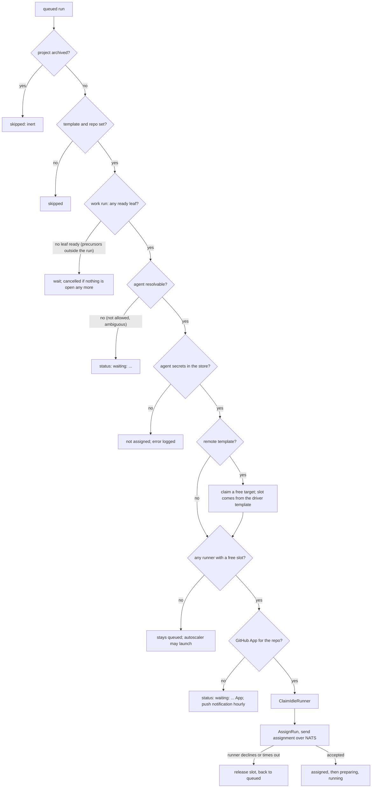

# Task scheduling

How a queued run becomes a running session, as the code does it today. Two loops do the work, both in
`cmd/wrangl/internal/controller/scheduler/`: the **autoscaler** (`Tick`, `scheduler.go`) launches
runners for demand, and the **assigner** (`Assign`, `assign.go`) hands queued runs to runners with a
free session. Both run on one ticker, every 10 seconds by default (`SchedulerInterval` in
`controller/server.go`): scale up first, then assign. Related: [tasks](tasks.md) (what a run is),
[runners](runners.md) (what a slot is), [projects](projects.md) (priority and allowed templates).

## 1. Concepts

- A **run** is queued by `wrangl task queue` (or auto-queue, a retry, a review of a new PR, and so on).
  A queued run has a **template** and a **repo** fixed at that moment.
- A **slot** is one agent session on a runner. A runner of a template has `max_sessions` slots (default 4).
  A slot is occupied by a run in any of these states: `assigned`, `preparing`, `running`,
  `needs_input`, `pushing`, `cancelling`. A run in `queued`, or in a final state (`succeeded`,
  `failed`, `blocked`, `cancelled`), holds none.
- **Demand** is queued runs wanting a template. **Supply** is free slots on runners of that template.
  The autoscaler launches runners for the gap; the assigner fills slots.
- Nothing is placed by project. Any project's run may take any free slot on a runner of its template.
  Projects matter in two places only: queue order (priority), and which templates they may use
  (`--allow-template`).

## 2. How a run gets its template

When you queue a task (`stack.QueueWith`, `stack/service.go`) the run's template is the first one found
walking from the task up through its ancestors (`task create --template`), else the project's default
template (`project edit --template`). If none exists the queue is refused ("no runner template").
That id is stored on the run (`run.template_id`) and the assigner uses **only** that. The same goes for
the repo (task, then ancestors, then the project's only linked repo, or the notes repo for research).

Plan runs use the project's plan template if it has one. PR review, revise and Smart Merge runs use the
template of the work run they follow. The demand queries read
`COALESCE(run.template_id, task.template_id, project.default_template_id)`, which for queued runs is
always the stored run template.

A run whose template or repo is missing is skipped by the assigner.

## 3. Queue order

`QueuedRunsForAssignment` (`db/queries/run.sql`) returns queued runs of non-archived projects in this order:

1. **Project priority**, highest first (`project edit --priority N`).
2. **`queue_rank`**: runs you have reordered by hand (up/down or drag on the project page) come first,
   in the order you set; runs never reordered (`NULL`) come after.
3. **Task rank**: the queued task's rank among its siblings (a string key, `stack/rank.go`). This is the
   task's own position among its siblings, not its position in the whole tree.
4. **`queued_at`**: first in, first out.

The assigner walks that list once per tick and tries each run in turn. A run that cannot be placed
does not block the ones behind it: the loop moves on. So a run at the head of the queue that waits for a
missing secret does not hold up later runs on other templates, or even on the same one.

## 4. The flow

Per run, `assignOne` does in this order: load template and repo; resolve the **agent**; resolve its
**secrets**; for a remote template claim a **target**; check that a **free slot** exists; mint the
repo **GitHub token**; **claim a runner** (`ClaimIdleRunner`); mark the run `assigned` and send the
assignment to that runner with a 10-second NATS request. If the runner does not accept, the claim is
released and the run goes back to `queued`. The token is minted before the claim on purpose: a failure
there must not touch a runner, or a claim and release every tick would keep resetting its idle clock.

### Runner eligibility and packing (`ClaimIdleRunner`, `db/queries/run.sql`)

A runner is eligible for a run when all of these hold:

- it is a runner of the **run's template**;
- its state is `idle` or `busy` (not launching, enrolling, provisioning, offline or terminated);
- it is not **cordoned** and not **draining**;
- it has applied the template's **current version** (`template_version = version`);
- it is not marked for a **binary upgrade** (`upgrade_sha` empty);
- fewer than `max_sessions` runs occupy it.

Among eligible runners it prefers **busy** ones (packing: fewer instances, lower cost), then the one idle
longest. The claim sets the runner `busy` and clears its idle clock. Because the claim happens one run at
a time, the slot is not counted until the run is marked assigned right after.

## 5. What makes a run wait

| Cause | What you see | How it clears |
|---|---|---|
| **Unmet precursors** (a work run whose remaining leaves need tasks outside the run that are not merged) | still `queued`, no status text | the precursor merges; or `task needs rm`. If nothing is open any more the run is cancelled by the assigner. |
| **No free slot** | `queued`, no status text | a slot frees up, or the autoscaler launches a runner that enrols (section 6) |
| **No runner eligible although slots exist** | `queued` | all runners of the template are cordoned, draining, upgrading, on an older template version, or offline; uncordon, wait for the apply or upgrade, or launch another |
| **Agent not allowed / not resolvable** | `waiting: ...` on the run | change the agent (`task queue --agent`, `project edit --agent`) or `agent allow` |
| **Missing agent secret** | the run stays queued and the controller logs "agent X needs secret ..."; the Setup page's Agent credentials card shows it as missing | `wrangl agent auth` / `wrangl secret set` |
| **Missing GitHub App for the repo's owner, or not installed on it** | `waiting: ...` on the run, and a push notification at most once an hour per owner | add the account and install the App (Settings > GitHub accounts) |
| **Remote template, no free target** | `queued` | the autoscaler launches a target (within the template's `max_runners`); or `target list` |
| **Remote template, secret missing** | `waiting: ...` | `wrangl secret set` the connection's secret |
| **Project archived** | not listed; the run was cancelled on archive | restore the project and queue again |
| **Launch not allowed** (section 6) | `queued`; demand shown on the Workers page | raise the limit, fix the template |

A run waiting for a slot also gets a reason, with counts: `waiting: no runner of template T yet`, or
`waiting: no free slot on template T (2 full, 1 starting, 1 cordoned, draining or updating)`; a remote
template with no free target says `waiting: no free target for template T`, and a work run whose
precursors are unfinished says so. The text is stored with the run (`blocked_reason`, `blocked_since`),
rewritten only when it changes, and cleared when the run is assigned.

## 6. The autoscaler

Each tick the planner (`placer.Place`, run by `Tick`) takes the queued runs of non-archived projects in
assignment order and packs them virtually:

1. **Existing runners.** A run goes to the best claimable runner it fits (the project's allowed templates,
   usually the host, first): not cordoned, not draining, not marked for upgrade, not closed by the guard,
   at the template's current version, with enough free vCPU, RAM and disk (the run's need snapshot against
   the runner's capacity less what active runs reserved) and a free session under the template's
   `max_sessions`. With the default `0/0/0` needs only the session ceiling matters.
2. **Runners that are coming up.** A launching, enrolling or provisioning runner counts with all its
   capacity (including ones planned earlier in the same pass): the run waits for it and no launch is made.
3. **Launch.** Only then does it plan a launch: of the template's instance-menu entries that could hold the
   run (a template with no menu has one entry, its own choice) it picks the lowest price per hosted run,
   crediting the launch with every later queued run that fits the same box (ties: more hosted runs, lower
   price, name), and sizes the volume to the hosted disk needs plus the reserve.

A launch is allowed only if the template has room (`max_runners` minus its live runners, adopted ones
included) and, when an hourly budget is set, committed spend plus the launch stays within it (section 9).
These guards still stop a template from launching at all:

- **Failed version.** If the template's current version failed to apply (`failed_version = version`),
  nothing launches (one warning is logged). Fix it with `wrangl template edit`.
- **Backoff.** After a failed launch (an AWS error), that template backs off for 1 minute, doubling per
  consecutive failure up to 30 minutes.
- **Enrolment failures.** After 3 launched runners of the template never enrolled within the last hour,
  launching pauses and the owner gets a notification (at most hourly).

Each launched runner is recorded as `launched_for_project` for the project of the first run it was planned
for (attribution only: there are no per-project instance limits any more; the old `--limit` and its
`project_template_limit` table were removed, so a project can cause as many launches as the template's
`max_runners` and the budget allow).

**Remote templates** (Mac, Android) launch **targets** instead (`tickRemote`), within the template's
`max_runners`, with the same backoff. A run on a remote template needs two slots at once: a free target and
a free session on its **driver** template; the planner counts the driver session as demand on the driver
template, and the assigner claims neither until both exist.

**Manual launch.** `wrangl fleet launch --template T [--count N]`, the Launch buttons on the Workers page
and in Settings, and the controller agent's `fleet.launch` proposal (1 to 5 runners, refused if it would
exceed the template's `max_runners`) bypass demand. `fleet.Launch` itself checks no limit, so the CLI and
the buttons can exceed `max_runners`; the agent's proposal goes through `LaunchFor`, which enforces it.

**Idle reaping** (fleet loop, 30 s; `fleet.Reap`): a launched runner idle (or offline) longer than the
template's `idle_timeout` (default 30m) is terminated; one stuck launching or enrolling for 15 minutes
too. A runner open in a web terminal is not reaped while idle. Adopted runners, including the host
runner, are never reaped. The reaper and the autoscaler do not coordinate beyond this: a runner reaped
this tick can be relaunched on a later one if demand returns.

**Removed in this release.** The slot-based tick (`placement.engine: legacy`, the default until now), the
per-project instance limits (`wrangl project edit --limit`, the "Runner limits" card, the concurrency chip)
and the `project_template_limit` table are gone. A `placement.engine` key in `controller.yaml` is still
read but ignored (with a warning). With the default `0/0/0` needs and no budget the planner launches the
runners the old tick would have, except that a project is no longer capped at one instance of its default
template (nor at zero of the others): limit an expensive template with its `max_runners`, or with the
budget. If you relied on a project cap of 0 to keep a project off a Mac or Android template, set that
template's `max_runners` instead, or do not let the project queue work on it.

## 7. A worked example

Template `go-claude`: `max_sessions: 4`, `max_runners: 3`, no menu, default `0/0/0` needs. One runner
exists (`r1`) and has 2 of 4 session slots occupied. Queued: 6 runs of project `api` (priority 5), then 3
of `web` (priority 1).

1. **Existing runner.** The first two queued runs (`api`) fit the 2 free sessions on `r1`.
2. **Launch.** The next run (`api`) fits nothing, so a runner is planned: it can host 4 sessions, so it is
   credited with the next 3 runs (the last `api` runs, then the first `web` run). The run after that opens a
   second planned runner, credited with the remaining 2 `web` runs. Two launches; `live` becomes 3 =
   `max_runners`. Had `max_runners` been 2, the second launch would be refused and the last `web` runs
   would wait with the reason "no free slot" (and an Inbox item after 15 minutes).
3. **Assignment, same tick.** The two free slots on `r1` go to the first two queued runs in order:
   `api` (priority 5) before `web`, and within `api` by `queue_rank`, then task rank, then `queued_at`.
4. **While the new runners boot.** The two new runners count their slots, so no further launches. As each
   runner enrols and applies the template it becomes `idle`, and the assigner fills its slots in queue order.
5. **Afterwards.** When the queue empties the runners go idle, and 30 minutes later (the default
   `idle_timeout`) the two launched ones are terminated, and `r1` too if it is launched and idle that long.

## 8. Why is my run waiting?

Work down this list.

1. **Look at the run.** `wrangl run show ID` (the status line) or the run page `/run/ID`. A
   `waiting: ...` text names the cause (agent, secret, GitHub App). `wrangl run list --state queued` shows
   the Status column for all queued runs. `run show` also prints `waiting since`; the run page shows the
   same, and each Queue row on the project page carries the reason beside the run link.
2. **Is it behind other work?** The Queue section is in assignment order. Runs above it, on its template,
   hold the free slots first. A higher-priority project goes ahead of yours.
3. **Is there a slot?** Workers page: the Templates card shows `N queued · live/max` per template. A
   runner card shows its run; `wrangl fleet show NAME` shows state, cordon/drain flags, applied template
   version and binary state. A runner that is cordoned, draining, `(upgrading)`, provisioning or on an
   older template version takes nothing.
4. **Will one be launched?** Only if `live` is below the template's `max_runners` (the Templates card), the template's current version has not failed to apply, and fewer than 3 of its
   recent runners failed to enrol. Check the controller log for "not launching", "backing off" and
   "failed to enrol".
5. **Precursors.** `wrangl task show SQID` lists unmet precursors; a work run whose remaining leaves
   need tasks outside the run does not start, and a run with nothing left to do is cancelled.
6. **Agent and credentials.** `wrangl agent list`, and Setup > Agent credentials for missing secrets.
7. **GitHub App.** `wrangl repo link` errors and the Setup page state ("Ready" or not) for the owner.
8. **Archived?** `wrangl project list --archived`.

## 9. Known limits

> These are the behaviours that surprise people today. [ADR 0009](../adr/0009-resource-based-placement.md)
> (resource needs, an hourly cost budget, the host as a placement target) is built; the capability-tag half
> is still in [ADR 0007](../adr/0007-capabilities-and-capacity.md) and not built.

- **One template per run, unless the project allows more.** A run is bound to the single template
  resolved when it was queued. By default, if every runner of that template is busy, capped or cordoned,
  the run waits even when another template's runners sit idle. A project can opt in to more with
  `wrangl project edit SLUG --allow-template host`: its runs then try the allowed templates' runners
  first (so a free host is used before cloud runners), then their own template's, and the autoscaler
  counts free allowed slots as supply, launching only on overflow. Agent allow-lists, secrets and
  session limits are those of the template whose runner is used.
- **The host is invisible to projects that do not allow it.** The adopted host runner belongs to one
  template (usually `host`); without `--allow-template host` a run queued on any other template never
  uses it, however idle it is. It also counts toward `live` for its template's `max_runners`, which can
  leave less room to launch cloud runners of that template.

  One-time owner action to let the `wrangl` project use the host and overflow to EC2 (it is pinned to a
  single template today):
  `wrangl project edit wrangl --template go-claude --allow-template host`
  (the template's `max_runners` bounds the overflow runners). Queued and new runs of the project then fill the host's
  slots first and launch `go-claude` runners only for what does not fit.
- **Resource needs.** ADR 0009 adds a resource need (vCPU, RAM,
  disk) per task, layered default < project < task: `wrangl placement show|set --need ram=2GiB`,
  `wrangl project edit SLUG --need ram=4GiB`, `wrangl task create|edit --need ram=8GiB` (empty value
  clears a field; owner floors 1 vCPU / 512 MiB / 1 GiB; Settings has a Placement card for the
  defaults). Agent tools (`task_create`, `task_update`) may only raise a need. The default is `0/0/0`
  ("not set"). When a run is queued (work, plan, review, revise, resolve) the resolved set is copied
  onto it (`run.need_*`, with `need_source` saying which layer each field came from). Editing a default,
  project or task affects runs queued afterwards, never queued or running ones; a retry is a new run
  and gets a new snapshot.

  Runners also have a capacity now: a launched runner holds its facts minus a reserve (1 GiB RAM, 8 GiB
  disk); the adopted host defaults to 6 vCPU / 12 GiB / 20 GiB (never above 75% of its vCPU and RAM or 70%
  of its disk). Set it explicitly with `wrangl fleet set host --capacity vcpu=6,ram=12GiB,disk=20GiB`
  (an empty value derives that field again). `fleet show` and the runner card show reserved/capacity per
  resource; the session ceiling is copied from the template when a runner enrols.

  Assignment uses all of this. A run fits a runner when the runner is claimable (as before), the template's
  `max_sessions` has room, and every resource the run needs (non-zero) is free (capacity minus what active
  runs reserved). Among the runners that fit: the cheapest (the free host first), then the fullest (least
  left over), then busy before idle, then the longest idle. The claim is one conditional statement that
  re-checks all of it. With the default `0/0/0` needs nothing but the session ceiling limits a runner and
  the order is busy-then-longest-idle, so behaviour is as before until you set real needs.

  **Launching by resources** is section 6: with needs and an instance menu the planner launches the
  machine that hosts the queued runs most cheaply. A run whose need exceeds every machine its template can launch and every
  runner it may use is raised in the Inbox at once as "can't be placed" (permanent: no *Keep waiting*),
  with *Edit this task's needs* (opens the task; lowering the needs from there re-resolves the queued run
  and the item resolves itself on the next tick), *Use template X* for templates that could hold it, and
  *Cancel the task's run*. *Edit this task's needs* is also offered on the temporary items.
- **Capability tags and requirements.** Placement can also match on what a runner can *do*, not just
  its size. A **template provides tags**: `arch=arm64`, `agent:claude` for each agent on its allow-list,
  `tool:go=1.22` for each tool in its mise `[tools]`, plus whatever its file lists under `provides:`
  (`provides: [net=vpn, gpu=none]`). A **runner carries** its template's tags, plus what it probed about
  itself at enrolment (`tool:docker`, and `agent:claude=authed` when claude is installed and signed in); tags
  are kept in step with the template every few minutes. A **project, task or queued run requires** tags:
  `wrangl project edit SLUG --require tool:go>=1.22 --require net=public|vpn`, `wrangl task create|edit
  --require gpu` (`--unrequire KEY` removes one). Forms: `key=value`, `key>=1.22` (dotted version at
  least), `key=a|b` (one of), bare `key` (present). A task's requirement on a key replaces the project's
  for that key. The resolved set is copied onto the run when it is queued (like needs), together with
  `agent:NAME` for the agent it will use, so a runner whose template does not allow that agent is skipped
  instead of tried and failed. A run fits a runner only if the runner's tags satisfy all of it (this is the
  capability line of `Fits`); the planner launches only menu entries whose template provides the tags; a
  requirement no template provides raises the "can't be placed" item at once (reason `no_capability`, no
  *Keep waiting*) and it resolves itself when the requirement is changed. `fleet show`, `template show`
  and the runner card show tags. Nothing requires anything by default, and a runner with no tags yet is
  unrestricted, so existing setups behave as before.
- **The measured guard (off by default).** Reservation says what was promised; the guard says what is
  true. `wrangl fleet set host --guard load1=6,mem=85,disk=85` (empty value stops guarding one measure)
  closes a runner to **new** assignments when its heartbeat shows load, memory or disk over a threshold for
  two samples in a row, and reopens it after two samples under 90% of every threshold. Running sessions are
  never touched. A closed runner is not claimable and not supply (so the autoscaler launches elsewhere),
  shows a "closed" pill with the reason (`disk 87% > 85%`) on its card, in `fleet show`, and writes a Logs
  note when it closes or reopens. No thresholds, no guard.
- **Hourly budget.** `wrangl placement set --budget 0.50` sets an hourly cost ceiling (`--budget none`
  removes it). Each launched runner gets its price stamped (instance price plus its volume at the gp3 rate;
  a menu entry with no known price is not launched while a budget is set: give it `price:` in the
  template). *Committed* spend is the sum over every runner that has not been terminated, so launching,
  draining and offline runners count; the host is free; launches planned earlier in the same pass count
  too. A launch is allowed only if committed plus its price stays within the budget (an EC2 Mac host counts
  24 hours of its price). `placement show`, `fleet list` and the Workers page show spend against the budget,
  and a Logs note fires once at 80%, re-arming below 70%.

  At the ceiling the run waits and says exactly why (`waiting: hourly budget $0.50 reached ($0.47 in use;
  c7g.xlarge would add $0.145)`). Before giving up the scheduler reclaims: an idle launched runner with no
  active run that cannot host any queued run is terminated now instead of after its idle timeout, so the
  next tick can launch. Runners that could host a queued run are never reclaimed. A template's
  `max_runners` still applies as a backstop. With no budget nothing is gated by cost. Mac targets are not
  in the sum yet, and runners launched by hand (`fleet launch`) have no price stamped, so they are not
  counted.

  A run held back by the budget for 15 minutes raises the "can't be placed" item ("Hourly budget
  reached: $0.47 of $0.50 in use"), with *Raise budget to $X/h* (the smallest budget, rounded up to the
  cent, that places the run: you click it, nothing raises the budget on its own), *Edit this task's
  needs*, *Keep waiting* and *Cancel the task's run*. If the cause is an unknown price instead, the item
  says to give the template an explicit `price:` and has no raise option. You get one push notification
  per item; it resolves itself when the run is no longer held back, for example after other runs finish
  and idle runners are reclaimed.
- **The Inbox item "can't be placed".** A queued run only you can get placed shows an `unplaceable`
  item with the options *Keep waiting* (temporary reasons; raised again after 24 hours or if the reason
  changes), *Use template X* (moves the task and its queued run) and *Cancel the task's run*. There is
  one open item per run; it resolves itself when the run is assigned or no longer queued. The scheduler
  raises it when the run's template is gone (at once, no *Keep waiting*), and, after the run has waited
  15 minutes with no runner live, starting or free on its template, when the template's current version
  failed to apply, the enrol brake paused launching, or the template is at
  `max_runners` (the temporary reasons `launch_blocked` and `capacity`). A run that merely waits for a
  busy or starting runner never raises it.
- **Runs waiting on precursors still count as demand.** Queued work runs with no ready leaf are
  included in `demand`, so they can cause a launch for slots that stay empty.
- **`needs_input` runs hold their slot.** A run waiting on your answer still occupies a session, so one
  runner can be filled by runs that are waiting for you.
  An optional policy relaxes this for vCPU only: `wrangl placement set --needs-input-grace 10m`. A run
  whose question has been open longer than that stops reserving vCPU on its runner (it burns no CPU while
  it waits for you), so new runs can use it; RAM, disk and the session slot stay reserved. `off` (the
  default) turns it off. If the agent resumes onto a busy box it simply shares the CPU.
- **A missing agent secret is not shown on the run.** It is logged by the controller and shown on the Setup
  page, but the run's status text stays empty.

## See also

[Projects](projects.md) (priority and allowed templates), [Tasks](tasks.md) (runs and needs), [Runners](runners.md) (templates, versions, cordon), [index](../README.md).
