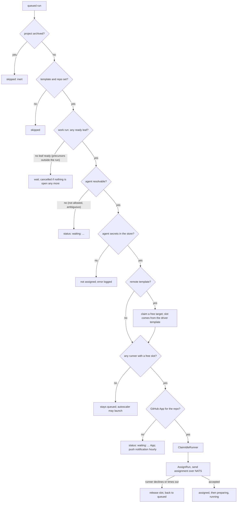

# Task scheduling

How a queued run becomes a running session, as the code does it today. Two loops do the work, both in
`cmd/wrangl/internal/controller/scheduler/`: the **autoscaler** (`Tick`, `scheduler.go`) launches
runners for demand, and the **assigner** (`Assign`, `assign.go`) hands queued runs to runners with a
free session. Both run on one ticker, every 10 seconds by default (`SchedulerInterval` in
`controller/server.go`): scale up first, then assign. Related: [tasks](tasks.md) (what a run is),
[runners](runners.md) (what a slot is), [projects](projects.md) (priority and limits).

## 1. Concepts

- A **run** is queued by `wrangl task queue` (or auto-queue, a retry, a review of a new PR, and so on).
  A queued run has a **template** and a **repo** fixed at that moment.
- A **slot** is one agent session on a runner. A runner of a template has `max_sessions` slots (default 4).
  A slot is occupied by a run in any of these states: `assigned`, `preparing`, `running`,
  `needs_input`, `pushing`, `cancelling`. A run in `queued`, or in a final state (`succeeded`,
  `failed`, `blocked`, `cancelled`), holds none.
- **Demand** is queued runs wanting a template. **Supply** is free slots on runners of that template.
  The autoscaler launches runners for the gap; the assigner fills slots.
- Nothing is placed by project. Any project's run may take any free slot on a runner of its template.
  Projects matter in three places only: queue order (priority), launch caps (limits), and which
  project's demand the autoscaler serves first.

## 2. How a run gets its template

When you queue a task (`stack.QueueWith`, `stack/service.go`) the run's template is the first one found
walking from the task up through its ancestors (`task create --template`), else the project's default
template (`project edit --template`). If none exists the queue is refused ("no runner template").
That id is stored on the run (`run.template_id`) and the assigner uses **only** that. The same goes for
the repo (task, then ancestors, then the project's only linked repo, or the notes repo for research).

Plan runs use the project's plan template if it has one. PR review, revise and Smart Merge runs use the
template of the work run they follow. The demand queries read
`COALESCE(run.template_id, task.template_id, project.default_template_id)`, which for queued runs is
always the stored run template.

A run whose template or repo is missing is skipped by the assigner.

## 3. Queue order

`QueuedRunsForAssignment` (`db/queries/run.sql`) returns queued runs of non-archived projects in this order:

1. **Project priority**, highest first (`project edit --priority N`).
2. **`queue_rank`**: runs you have reordered by hand (up/down or drag on the project page) come first,
   in the order you set; runs never reordered (`NULL`) come after.
3. **Task rank**: the queued task's rank among its siblings (a string key, `stack/rank.go`). This is the
   task's own position among its siblings, not its position in the whole tree.
4. **`queued_at`**: first in, first out.

The assigner walks that list once per tick and tries each run in turn. A run that cannot be placed
does not block the ones behind it: the loop moves on. So a run at the head of the queue that waits for a
missing secret does not hold up later runs on other templates, or even on the same one.

## 4. The flow



Per run, `assignOne` does in this order: load template and repo; resolve the **agent**; resolve its
**secrets**; for a remote template claim a **target**; check that a **free slot** exists; mint the
repo **GitHub token**; **claim a runner** (`ClaimIdleRunner`); mark the run `assigned` and send the
assignment to that runner with a 10-second NATS request. If the runner does not accept, the claim is
released and the run goes back to `queued`. The token is minted before the claim on purpose: a failure
there must not touch a runner, or a claim and release every tick would keep resetting its idle clock.

### Runner eligibility and packing (`ClaimIdleRunner`, `db/queries/run.sql`)

A runner is eligible for a run when all of these hold:

- it is a runner of the **run's template**;
- its state is `idle` or `busy` (not launching, enrolling, provisioning, offline or terminated);
- it is not **cordoned** and not **draining**;
- it has applied the template's **current version** (`template_version = version`);
- it is not marked for a **binary upgrade** (`upgrade_sha` empty);
- fewer than `max_sessions` runs occupy it.

Among eligible runners it prefers **busy** ones (packing: fewer instances, lower cost), then the one idle
longest. The claim sets the runner `busy` and clears its idle clock. Because the claim happens one run at
a time, the slot is not counted until the run is marked assigned right after.

## 5. What makes a run wait

| Cause | What you see | How it clears |
|---|---|---|
| **Unmet precursors** (a work run whose remaining leaves need tasks outside the run that are not merged) | still `queued`, no status text | the precursor merges; or `task needs rm`. If nothing is open any more the run is cancelled by the assigner. |
| **No free slot** | `queued`, no status text | a slot frees up, or the autoscaler launches a runner that enrols (section 6) |
| **No runner eligible although slots exist** | `queued` | all runners of the template are cordoned, draining, upgrading, on an older template version, or offline; uncordon, wait for the apply or upgrade, or launch another |
| **Agent not allowed / not resolvable** | `waiting: ...` on the run | change the agent (`task queue --agent`, `project edit --agent`) or `agent allow` |
| **Missing agent secret** | the run stays queued and the controller logs "agent X needs secret ..."; the Setup page's Agent credentials card shows it as missing | `wrangl agent auth` / `wrangl secret set` |
| **Missing GitHub App for the repo's owner, or not installed on it** | `waiting: ...` on the run, and a push notification at most once an hour per owner | add the account and install the App (Settings > GitHub accounts) |
| **Remote template, no free target** | `queued` | the autoscaler launches a target (within the project's cap); or `target list` |
| **Remote template, secret missing** | `waiting: ...` | `wrangl secret set` the connection's secret |
| **Project archived** | not listed; the run was cancelled on archive | restore the project and queue again |
| **Launch not allowed** (section 6) | `queued`; demand shown on the Runners page | raise the limit, fix the template |

A run waiting for a slot also gets a reason, with counts: `waiting: no runner of template T yet`, or
`waiting: no free slot on template T (2 full, 1 starting, 1 cordoned, draining or updating)`; a remote
template with no free target says `waiting: no free target for template T`, and a work run whose
precursors are unfinished says so. The text is stored with the run (`blocked_reason`, `blocked_since`),
rewritten only when it changes, and cleared when the run is assigned.

## 6. The autoscaler

Each tick `Tick` reads one row per template (`TemplateDemand`, `db/queries/runner.sql`):

- **demand**: queued runs wanting this template, from non-archived projects. For a driver template, queued
  runs of remote templates that use it as their driver count too.
- **supply**: free slots (`max_sessions` minus occupied) summed over runners of the template that are
  not cordoned, not draining, not marked for upgrade, and in state launching, enrolling, provisioning,
  idle or busy. A runner still coming up counts **all** of its slots.
- **live**: runners of the template that are not terminated (adopted ones included).

Then, for each local template:

```
need   = demand - supply                      # sessions still without a slot
hosts  = ceil(need / max_sessions)            # each new runner brings max_sessions slots
room   = max_runners - live
n      = min(hosts, room)                     # n <= 0: nothing to do
```

and `n` runners are launched, unless a guard stops it:

- **Failed version.** If the template's current version failed to apply
  (`failed_version = version`), nothing launches (one warning is logged). Fix it with `wrangl template edit`.
- **Backoff.** After a failed launch (an AWS error), that template backs off for 1 minute, doubling per
  consecutive failure up to 30 minutes.
- **Enrolment failures.** After 3 launched runners of the template never enrolled within the last hour,
  launching pauses and the owner gets a notification (at most hourly).

**Who the launches are for.** `PlanLaunches` splits the `need` among projects in priority order
(`ProjectTemplateDemand`, highest priority first). For each project: share = min(its queued runs, need
left); hosts = min(ceil(share / max_sessions), cap minus the runners already launched for that project,
hosts left under `n`). The project cap is `EffectiveCap` = min(the project's `--limit` for the template,
the template's `max_runners`), where an unset limit is 1 for the project's default template and 0 for
any other ([projects guide, section 4](projects.md#4-runner-limits-and-the-effective-cap)). A project at
its cap does not push its demand onto another project; its runs wait. Each launched runner is recorded as
`launched_for_project`.

**Remote templates** (Mac, Android) launch **targets** instead (`tickRemote`), within the project cap
and the template's `max_runners`, with the same backoff. A run on a remote template needs two slots at
once: a free target and a free session on its **driver** template. Demand on the driver template is
added only as far as the project's cap on the remote template allows (a project capped at 0 Macs does not
cause idle drivers), and the assigner claims neither until both exist.

**Manual launch.** `wrangl fleet launch --template T [--count N]`, the Launch buttons on the Runners page
and in Settings, and the controller agent's `fleet.launch` proposal (1 to 5 runners, refused if it would
exceed the project's cap) bypass demand. `fleet.Launch` itself checks neither `max_runners` nor project caps, so the CLI and the
buttons can exceed them; the agent's proposal goes through `LaunchFor`, which enforces the project's
effective cap.

**Idle reaping** (fleet loop, 30 s; `fleet.Reap`): a launched runner idle (or offline) longer than the
template's `idle_timeout` (default 30m) is terminated; one stuck launching or enrolling for 15 minutes
too. A runner open in a web terminal is not reaped while idle. Adopted runners, including the host
runner, are never reaped. The reaper and the autoscaler do not coordinate beyond this: a runner reaped
this tick can be relaunched on a later one if demand returns.

## 7. A worked example

Template `go-claude`: `max_sessions: 4`, `max_runners: 3`. One runner exists (`r1`, launched for project
`api`) and has 2 of 4 slots occupied. Projects: `api` priority 5 with `--limit go-claude=2`; `web`
priority 1, `go-claude` as default template (cap 1). Queued: 6 runs of `api`, 3 of `web`.

1. **Demand and supply.** demand = 9. supply = 4 - 2 = 2. live = 1.
2. **Gap.** need = 9 - 2 = 7. hosts = ceil(7 / 4) = 2. room = 3 - 1 = 2. n = 2.
3. **Who gets them** (`PlanLaunches(need 7, perHost 4, maxHosts 2)`, `api` first):
   - `api`: share = min(6, 7) = 6; need left 1. cap = min(2, 3) = 2; already launched for it: 1.
     hosts = min(ceil(6/4) = 2, 2 - 1 = 1, 2) = **1**.
   - `web`: share = min(3, 1) = 1; hosts = min(1, 1 - 0 = 1, 1) = **1**.
   Two runners launch; `live` becomes 3 = `max_runners`.
4. **Assignment, same tick.** The two free slots on `r1` go to the first two queued runs in order:
   `api` (priority 5) before `web`, and within `api` by `queue_rank`, then task rank, then `queued_at`.
5. **While the new runners boot.** After the assignments `r1` has no free slot, and the two new runners
   count 4 slots each, so supply is 8 against 7 queued runs: no further launches. As each runner
   enrols and applies the template it becomes `idle`, and the assigner fills its slots in queue order,
   `api`'s remaining four runs first, then `web`'s three.
6. **Afterwards.** When the queue empties the runners go idle, and 30 minutes later (the default
   `idle_timeout`) the two launched ones are terminated, and `r1` too if it is launched and idle that long.

If `web`'s limit had been 0, step 3 would give `web` nothing, one runner would launch, and `web`'s runs
would wait until a slot freed on an existing runner, with no launch ever made for them.

## 8. Why is my run waiting?

Work down this list.

1. **Look at the run.** `wrangl run show ID` (the status line) or the run page `/run/ID`. A
   `waiting: ...` text names the cause (agent, secret, GitHub App). `wrangl run list --state queued` shows
   the Status column for all queued runs. `run show` also prints `waiting since`; the run page shows the
   same, and each Queue row on the project page carries the reason beside the run link.
2. **Is it behind other work?** The Queue section is in assignment order. Runs above it, on its template,
   hold the free slots first. A higher-priority project goes ahead of yours.
3. **Is there a slot?** Runners page: the Templates card shows `N queued · live/max` per template. A
   runner card shows its run; `wrangl fleet show NAME` shows state, cordon/drain flags, applied template
   version and binary state. A runner that is cordoned, draining, `(upgrading)`, provisioning or on an
   older template version takes nothing.
4. **Will one be launched?** Only if the project's cap for the run's template is above zero (the
   concurrency chip on the project page shows the template as `name xN`; absent means 0), `live` is below
   `max_runners`, the template's current version has not failed to apply, and fewer than 3 of its
   recent runners failed to enrol. Check the controller log for "not launching", "backing off" and
   "failed to enrol".
5. **Precursors.** `wrangl task show SQID` lists unmet precursors; a work run whose remaining leaves
   need tasks outside the run does not start, and a run with nothing left to do is cancelled.
6. **Agent and credentials.** `wrangl agent list`, and Setup > Agent credentials for missing secrets.
7. **GitHub App.** `wrangl repo link` errors and the Setup page state ("Ready" or not) for the owner.
8. **Archived?** `wrangl project list --archived`.

## 9. Known limits

> These are the behaviours that surprise people today. [ADR 0009](../adr/0009-resource-based-placement.md)
> (resource needs, an hourly cost budget, the host as a placement target) is the accepted fix, with the
> capability-tag half still in [ADR 0007](../adr/0007-capabilities-and-capacity.md). It is being built in
> stages and **none of it is built yet**: nothing below has changed. Interim: the `wrangl` project runs on
> the host template, so it uses the idle controller host's slots.

- **One template per run, no fallback.** A run is bound to the single template resolved when it was
  queued. If every runner of that template is busy, capped or cordoned, the run waits even when another
  template's runners sit idle; the scheduler never reassigns it to a compatible template.
- **The adopted host runner is invisible to projects on other templates.** It belongs to one template
  (usually `host`). A run queued on any other template never uses it, however idle it is. It also counts
  toward `live` for its template's `max_runners`, which can leave less room to launch cloud runners of
  that template.
- **Runs waiting on precursors still count as demand.** Queued work runs with no ready leaf are
  included in `demand`, so they can cause a launch for slots that stay empty.
- **`needs_input` runs hold their slot.** A run waiting on your answer still occupies a session, so one
  runner can be filled by runs that are waiting for you.
- **Project caps count launches, not usage.** The cap compares with `launched_for_project`, set when a
  runner is launched. A runner launched for project A and now used by B counts against A
  (see [ADR 0008](../adr/0008-runners-belong-to-the-system.md), also not built).
- **A missing agent secret is not shown on the run.** It is logged by the controller and shown on the Setup
  page, but the run's status text stays empty.

## See also

[Projects](projects.md) (priority and limits), [Tasks](tasks.md) (runs and needs), [Runners](runners.md) (templates, versions, cordon), [index](../README.md).
