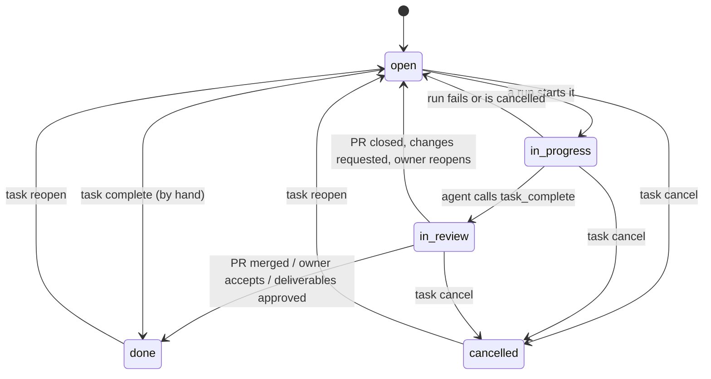
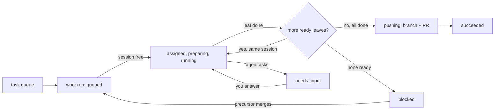

# Tasks

A task is one unit of work in a project's ranked tree. You write it, queue it, answer what its agent
asks, and review what comes back. This guide covers the tree, task types, states, dependencies,
runs, checkpoints, the Inbox, pull requests, deliverables and the CLI, and ends with a worked example.
Related: [projects](projects.md) (settings that change how tasks run), runners and scheduling (in this
directory as they are written).

## 1. The task tree

Every task belongs to one project and has an optional parent. Siblings are ordered by a **rank** (a
fractional-index string, `stack/rank.go`), so putting a task between two others never renumbers the
rest. The tree is what you see on the project page and in `wrangl task tree PROJECT`; a task is
addressed by its **sqid**, the short id shown next to it.

- A task with no children is a **leaf**. Only leaves do work and only leaves have their own state; a
  parent's state is computed from its children (section 3).
- A task that is `in_progress`, `in_review` or `done` and has no children cannot gain subtasks
  (`canGainChildren`). Split open tasks only.
- A task's **prompt** is what the agent is told. Make it self-contained: goal, constraints, what done
  looks like. Prompts of ancestors are passed along as context (section 5).
- A task may set `--template` and `--repo`; if it does not, it inherits from the nearest ancestor,
  then (template) from the project. A task whose subtree spans more than one repo cannot be queued as
  one run.

```sh
wrangl task create web --title "Add a health endpoint" --prompt "GET /healthz returns 200." [--parent SQID]
wrangl task create web --title "..." -f prompt.md --type bug --target-date 2026-12-01 --needs SQID
wrangl task move SQID --parent OTHER | --root   [--first | --last | --after SQ | --before SQ]
wrangl task edit SQID [--title T] [--prompt P | -f file] [--type TYPE] [--target-date YYYY-MM-DD]
```

Placement flags are `--first`, `--last` (the default), `--after SQID`, `--before SQID`. Creating a
top-level task in a project with `--auto-queue` on queues it at once.

### Splitting

`task split` adds subtasks to an open task in one step:

```sh
wrangl task split SQID --title "Write the handler" --title "Document it" --chain --copy-prompt
wrangl task split SQID -f outline.md          # one subtask per line; indent (2 spaces or tab) or bullets to nest
wrangl task split SQID --agent --guidance "split by package"   # plan with an agent
```

- `--chain` makes each top-level new subtask need the previous one (section 4).
- `--copy-prompt` copies the parent's prompt into subtasks that have none; otherwise they start empty.
- Subtasks take the parent's type. In an outline file a leading `[docs]`, `[bug]` ... sets one line's type.
- **Plan with an agent** (`--agent`, or "Split with agent" on the task page): wrangl queues a read-only
  `plan` run on the project's plan template (default template if unset) with your guidance. The agent
  explores the repo and calls `propose_split`; that creates a **plan review** Inbox item with
  **Accept** (the split is applied, chained if the agent said so), **Edit** (opens the split sheet with
  the proposal) and **Reject** (your text goes back as feedback and a new plan run is queued)
  (`controller/plans/plans.go`). Nothing changes until you accept.

## 2. Task types

The type tells the agent what kind of work this is and what to hand back, by adding a paragraph to its
prompt (`db/dbtypes/dbtypes.go`, `Guidance`). `code` adds nothing. A type also decides review:
`ux` and `architecture` pull requests **always wait for you**, even with auto-merge on.

| Type | Added to the agent's prompt | Result and review |
|---|---|---|
| `code` (default) | nothing | a pull request; gates, review run, auto-merge if allowed |
| `bug` | reproduce the defect, write a failing test first, fix the cause, state the root cause in the summary | a PR; as `code` |
| `ux` | two or three variants, each a mockup PNG (desktop and phone) under `docs/design/<sqid>/`, a prototype link or HTML file; do not change app code | PR and/or deliverables; the owner reviews visually, never auto-merged |
| `architecture` | write an ADR with at least two real alternatives; do not change app code | a PR with the ADR; the owner reads it, never auto-merged |
| `docs` | change documentation only and verify every command, path and behaviour against the code | a PR; as `code` (`spec` is an old alias) |
| `research` | a report in a fixed shape (Question, Recommendation, Analysis, Sources, Assumptions, Open questions, Confidence), committed under `research/` of the project's notes repo and also submitted as a `report_md` deliverable | a PR that only touches `research/` can auto-merge; with the project's citation audit on, unverified citations block it |
| `review` | read the code and report severity-ranked findings with `file:line`; do not rewrite | findings, no diff; the owner reads them |
| `release`, `milestone`, `feature` | container text: the prompt states the goal, work happens in subtasks | not run themselves (below) |

**Container types** group work: a release holds milestones, a milestone holds features and loose
tasks, a feature holds tasks, though nothing enforces the nesting. They carry a target date, a
progress roll-up (done/total leaves) and an at-risk / late flag computed from the date
(`stack/progress.go`). You can queue one: the run works through its subtree and never does the
container itself. Queueing a container with no subtasks is refused ("plan it first"). A release whose
leaves are all done waits in `in_review` until you **Ship it** (`wrangl task complete RELEASE`).

Subtasks inherit the parent's type unless you set one (`task create --type`, default: the parent's, else `code`).

## 3. States



- `open`: waiting. `in_progress`: a run is working on this leaf now. `in_review`: the agent says it
  is finished; the work waits for a PR to merge or for you. `done`: merged or accepted.
  `cancelled`: given up. Glyphs: ○ ▶ ◐ ✓ ✗.
- A **parent** is derived from its children, in this order: any child in progress → `in_progress`;
  else any open → `open`; else any in review → `in_review`; else any done → `done`; else `cancelled`
  (`recompute` in `stack/service.go`). You cannot set a parent's state; `complete` and `reopen` apply
  to leaves, and `cancel` cancels the task and all its unfinished descendants.
- `done` is reached by **merging**, not by the agent finishing. When a PR merges, every task the run
  completed becomes `done`, and runs that were waiting on them are continued (section 6).
- When a run ends without finishing a leaf (failure, cancel), the leaf goes back from `in_progress`
  to `open`.
- `task delete` removes a task and its subtree, and is refused while a run is working on any of it.

## 4. Needs (precursors)

`task needs add SQID PRECURSOR` says SQID cannot start until PRECURSOR is done; `needs rm` removes it.
Rules (`addNeed`): both tasks must be in one project, neither may be an ancestor of the other (that is
already implicit: a parent is done when its children are), and a dependency that would create a cycle
is refused.

How a run honours them (`NextReadyLeaf` in `db/queries/task.sql`): within the run's subtree the agent
is handed the first leaf in rank order, depth first, that is `open` or `in_progress` and whose
precursors are each either `done` or completed earlier **in the same run** (in review on the same
branch). So a chain inside one run goes straight through, one session, one branch. If open leaves
remain but none is ready (a precursor outside the run is not merged yet), the run ends in the
**blocked** state ("remaining tasks wait on precursors outside this run"). When a PR merges, the
controller looks at blocked runs and, if a leaf is now ready, queues the run again, on the same PR
branch if one is open (`continueBlocked` in `controller/prs/prs.go`).

## 5. Queueing and runs

`wrangl task queue SQID [--agent NAME]` creates a **work run** for the subtree rooted at SQID. It can
be any live task at any depth. It is refused, with the reason, when:

- a run is already working on an overlapping subtree;
- there is no open work (and says if subtasks are in review: merge them or request changes first);
- no runner template can be found (set one on the task, an ancestor, or the project);
- no repo can be found, or the subtree spans several repos;
- the agent you named is not allowed on the template.

`wrangl task dequeue SQID` takes a queued run back out; a running run is stopped with
`wrangl run cancel`. After queueing, the run waits for a free session (see the scheduling guide).

A run has a **kind**:

| Kind | Made by | What it does |
|---|---|---|
| `work` | `task queue` | works through the subtree's ready leaves in one agent session, on branch `wrangl/<sqid>-<attempt>`, and pushes |
| `plan` | `task split --agent` | read-only; proposes a split |
| `review` | the PR flow | read-only; reads the PR diff and calls `submit_review` with a risk (also used for the citation audit) |
| `revise` | `pr request-changes` | works on the existing PR branch from your instructions |
| `resolve` | `pr resolve` (Smart Merge) | merges the base branch into the PR branch and resolves conflicts |

**Attempt** is the number of runs the task has had, plus one; the branch name carries it. A run
**continues** a branch (the runner clones the existing branch instead of the base) when it is a
revise, resolve or plan run, or a work run re-queued after being blocked.

The prompt for each leaf is composed per turn (`composePrompt`): "You are working on task SQID:
TITLE", the type's paragraph, the task prompt, the **context from the parent tasks** (each ancestor's
title and prompt, outermost first), the tasks already completed earlier in this session with their
summaries, and the instruction to work only on this task and finish with `task_complete`.

Run states: `queued → assigned → preparing → running ⇄ needs_input → pushing →` one of `succeeded`,
`failed`, `blocked`, `cancelled` (`cancelling` on the way). `needs_input` means an agent question is
open.



### Checkpoints

After each leaf the runner commits whatever the agent left uncommitted as `[sqid] title`, pushes the
run branch, and reports the commit to the controller. The task page then shows **Changes `abc1234`**
(the commit on GitHub) and **Compare** (against the previous task's checkpoint in that run, or the
default branch for the first). The result is one commit per task on one branch. Read-only runs (plan,
review) do not checkpoint.

## 6. Inbox: questions and reviews

Everything that waits on you is a **question** with options, shown in the Inbox, in the project's
"Needs you" strip, and via web push. `wrangl question list|show|answer ID [OPTION] [--text ...]`.

| Kind | Raised when | Options |
|---|---|---|
| agent question | the agent calls `ask_question` (the run goes `needs_input`; your answer returns into its session) | the agent's options and/or free text |
| **"What now?"** | the agent ended two turns without calling `task_complete` (the runner nudges once, then asks) | Retry the task, Mark it complete, Fail the run, or type a reply and the agent resumes with it |
| approval | an agent action needs your OK (cancelling or deleting a task it did not create, closing an issue), or a lost or silent run needs a decision (re-queue, cancel) | Approve / Deny |
| plan review | a plan run proposed a split | Accept / Edit / Reject (section 1) |
| task review | a leaf is in review but no PR will come (a run that pushed nothing), or its last work run failed or was blocked | Accept / Reopen with feedback; for a failure, Retry / Cancel task |
| PR review | a PR needs your decision (section 7) | Approve & merge / Request changes / Close |
| deliverable review | a run completed tasks, pushed nothing and left deliverables | Approve / Request changes |
| tool failure | a tool call the controller ran for the agent failed for a service reason (e.g. the GitHub App lacks `issues: write`) | Dismiss; the run carries on |

Free-text feedback on a *Reopen* or *Request changes* is appended to the task's prompt as "Owner
feedback", so the next run and the history have it. Check the Inbox first when a run seems stuck.

## 7. Pull requests

When a work (or revise or resolve) run pushes, the controller opens one PR for the whole subtree,
titled `[sqid] title`, with the completed tasks listed in the body. Then, for each head commit
(`controller/prs/prs.go`, `Evaluate`):

1. **Gates.** CI is green (or there is none), changed lines are at most the project's limit (default
   200), no changed file matches the protected paths (default `.github/**`, `**/migrations/**`,
   `go.mod`, `**/*.tf`, `Dockerfile*`), and for research tasks only `research/` changed. While CI is
   pending, nothing happens until a webhook or the poll returns.
2. **Review run.** A read-only run reads the diff and calls `submit_review` with **risk** low,
   medium or high, a summary and concerns. One review per head commit. (With the citation audit on, a
   research PR gets an audit run too.)
3. **Decision.** The PR is merged for you only if the project has `--auto-merge`, the task type is not
   `ux` or `architecture`, every gate passed, the risk is **low**, the review is of the current head,
   and any citation audit is clean. Otherwise you get a **PR review** question showing risk, CI,
   lines, protected paths, conflicts and the review text.
4. **Conflicts.** wrangl tracks whether each open PR is mergeable. A conflicted PR shows a
   "conflicts" pill and **Smart Merge** (`wrangl pr resolve ID`): a `resolve` run merges the base in
   (never a rebase or force-push), resolves each conflict from both sides' intent, runs the tests and
   pushes; if nothing conflicts it calls GitHub's update-branch instead. Auto-merge never attempts a
   conflicted PR: with `--auto-resolve` it queues Smart Merge, otherwise it asks you.

Your answers: **Approve** merges (squash) and marks the tasks `done`; **Request changes** (needs text)
queues a `revise` run on the same branch, after which the PR is reviewed again; **Close** closes the PR
on GitHub and **reopens** its tasks. A PR merged or closed directly on GitHub is picked up by webhook.
CLI: `wrangl pr list|show|approve|request-changes -m TEXT|close|resolve`.

## 8. Deliverables

Work that is not a diff (mockup images, a prototype HTML file or link, a link, a markdown report) is
handed back with `submit_deliverable`. They appear on the task page under **Deliverables** (images in
a gallery with a lightbox, reports and prototypes in expandable sections; a report's Sources heading
becomes a side panel), and are kept for 90 days. If a run completed tasks, pushed nothing and left
deliverables, a **deliverable review** question asks you to approve (tasks become `done`) or request
changes (your text is added to the prompt and the task is queued again).

## 9. CLI reference

| Command | Purpose |
|---|---|
| `task tree PROJECT\|SQID [--all]` / `task list [--project --parent --state]` / `task show SQID` | look (show lists precursors, runs, history) |
| `task create PROJECT --title ...` | flags in section 1, plus `--issue owner/name#N`, `--repo`, `--template` |
| `task edit` / `task move` / `task split` | section 1 |
| `task needs add\|rm SQID PRECURSOR` | section 4 |
| `task queue SQID [--agent]` / `task dequeue SQID` | section 5 |
| `task complete SQID [-m]` / `task reopen SQID` / `task cancel SQID [-m]` / `task delete SQID` | change state; leaves only for complete and reopen |
| `task ask SQID "question" [--agent NAME] [--wait]`, `task thread SQID`, `task apply MSGID N` | ask a controller agent about the subtree; approve its proposed actions (N is 0-based) |
| `run list\|show\|attach\|diff\|files\|cat\|cancel`, `logs RUN` | the runs |
| `question list\|show\|answer`, `pr ...` | the Inbox and PRs |

## 10. A worked example

Add a health endpoint with a test and a README note, using a project `web` whose repo is linked and
that has `--auto-merge` on.

```sh
# 1. Create the task and split it into a chain
wrangl task create web --title "Add a health endpoint" --prompt "Add GET /healthz returning 200 with body ok."
wrangl task tree web                         # note the sqid, say k3Xp9a
wrangl task split k3Xp9a --title "Write the handler and a test" --title "Document it in the README" --chain
```

`k3Xp9a` is now a parent with two open children; the second needs the first.

```sh
# 2. Queue the parent
wrangl task queue k3Xp9a
wrangl run list --state active               # run 41, work, branch wrangl/k3Xp9a-1
```

3. The run is assigned to a session. The agent gets the first leaf (the second is not ready: its
   precursor is not done yet, but it will be once the first is completed in this run). The first leaf
   goes `in_progress`. The agent edits, calls `task_complete`; the leaf goes `in_review`, and the
   runner commits `[ab12cd] Write the handler and a test`, pushes, and records the checkpoint.
4. In the same session the second leaf is now ready (its precursor is completed in this run). It
   goes through the same steps, adding a second commit. No ready leaves remain, the run goes
   `pushing`, and the controller opens a PR titled `[k3Xp9a] Add a health endpoint`. The parent shows
   ◐ in review.
5. CI runs. When it passes, gates are checked, and a review run reads the diff and submits risk `low`.
   Gates passed, risk low, type `code`, auto-merge on: the PR is squash-merged.
6. Merge marks both leaves `done` and the parent follows. If it had not auto-merged, a "Review PR"
   item would be in the Inbox:

```sh
wrangl question list                          # kind pr_review
wrangl question answer 17 request_changes --text "return JSON {\"status\":\"ok\"}"   # queues a revise run
wrangl question answer 17 approve
```

7. `wrangl task show k3Xp9a` shows the runs, the PR and the history; the task page links each task's
   **Changes** to its commit.

## 11. Troubleshooting

| Symptom | Cause and fix |
|---|---|
| `task queue` says "has no open work: N subtask(s) are in review" | Merge or request changes on their PRs, or `task reopen` a subtask. |
| `task queue` says "overlaps a subtree a run is already working on" | Another run holds part of the subtree. `wrangl run list --state active`; wait, or `run cancel`. |
| "no runner template" / "no repo" / "spans more than one repo" | Set `--template` / `--repo` on the task or an ancestor, or on the project; queue single-repo subtrees separately. |
| Queued but never starts | See the run's status text (`wrangl run show ID`) and the scheduling guide: no free session, template at `max_runners`, missing agent secret. |
| Run ended `blocked` | Remaining leaves need tasks outside the run. Finish or merge those; the run is re-queued when a PR merges, or `task queue` again. |
| Leaf stays `in_review` and no PR appears | The run pushed nothing: a task-review item is in the Inbox (Accept / Reopen). Or CI is pending, or the PR needs your decision. |
| Task `in_review`, PR merged on GitHub | The webhook or the 15-minute reconcile poll marks it done; check the webhook path in INSTALL step 10. |
| "What now?" card in the Inbox | The agent twice finished a turn without `task_complete`. Read its last message, then Retry, Mark complete, Fail, or reply in text. |
| `task complete` / `reopen` fails: "has subtasks" | Parent states follow their children; act on the leaf. |
| `task delete` refused | A run is working on the subtree; cancel it first. |
| A split was rejected as "only open tasks can be split" | The task is in progress, in review or done. Reopen it, or add subtasks to a different parent. |
| Auto-merge did not merge | It needs every gate, risk low, a type other than `ux`/`architecture`, and no conflicts; the PR-review question says which failed. |

## Delegating from a shell or an agent

`wrangl delegate "<title>" -f prompt.md --queue [--project P]` creates the task under a per-project **Delegated**
feature (created on first use) and queues it in one step; `wrangl task wait <sqid> [--timeout 30m]` blocks until
it is done, waiting for review, cancelled, or open again after a failed run, and prints the outcome (exit 0 for done
or review, 1 otherwise). The project is inferred from `WRANGL_PROJECT`, `WRANGL_TASK`, or a `.../primary/<slug>`
directory. See ADR 0011 section 5.

## See also

[Projects](projects.md), [Runners](runners.md), [Task scheduling](scheduling.md) (what happens between `task queue` and a running session), [index](../README.md).
